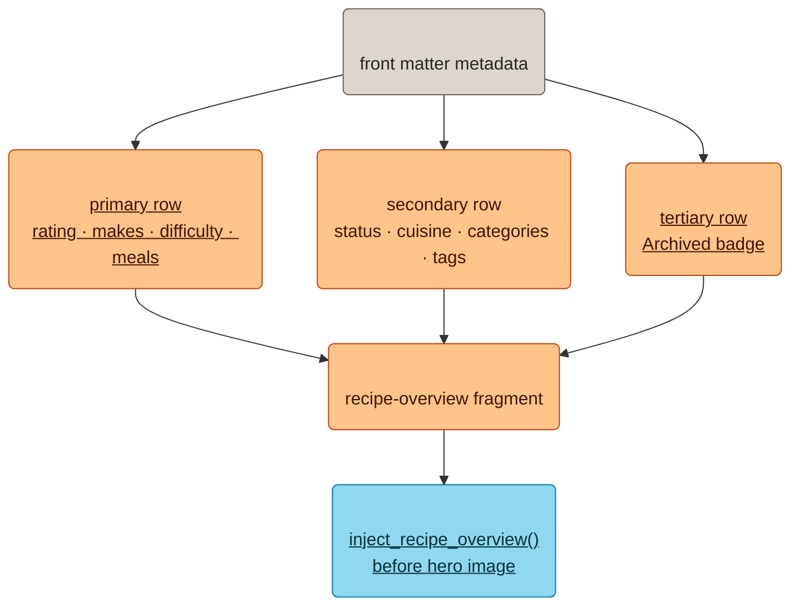

# The recipe overview block (`src/recipeserver/markdown_to_html/overview.py`)

Builds the three-row "overview" strip injected into recipe pages above the hero image:

1. **Primary** — average rating (`★ 8.5/10`), makes (a "I made this!" button), difficulty (`n/10`), meals.
2. **Secondary** — status, cuisine, categories (legacy `category` accepted via `read_categories`), tags. Multi-value fields render every value; `status` is collapsed to the first value.
3. **Tertiary** — an "Archived" badge when `archived` is true in front matter.

Rows are only rendered when at least one of their values is present; the whole block returns `None` when nothing applies.

## Public surface

- `build_recipe_overview(metadata, soup)` — returns the `
` fragment (or `None`).
- `inject_recipe_overview(soup, metadata)` — inserts the fragment before the hero image (the `` after the first `<h1>`), after the title.
- `first_scalar(value)` — unwraps a single-item list.

Icons come from [icons.py.md](icons.py.md) (chef-hat, gauge, utensils, pot, pin, tag, info, archive). Rating math reuses `iter_valid_rating_entries` from [recipe_utils.py.md](../recipe_utils.py.md) — invalid rating entries are skipped.

## Related pages

- [converter.py.md](converter.py.md) — calls `inject_recipe_overview` during postprocessing
- [extras.py.md](extras.py.md) — the sibling blocks appended after `<main>`
- [README.md](../README.md) — the package hub
