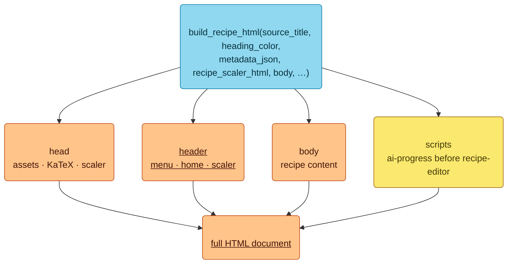

# The page shell (`src/recipeserver/markdown_to_html/page.py`)

Assembles the full HTML document for a recipe page: `<head>` asset references, the header with the sandwich menu, the home icon and the recipe scaler, and the `<script>` block at the end of `<body>`.

## Key contents

- Asset path constants (`CSS_PATH`, `RECIPE_JS`, `AI_ASSISTANT_JS_PATH`, …) — all root-absolute `/assets/...` URLs, which is why generated pages must be served from the site root. `_versioned_assets()` appends a content hash to each (`?v=<sha1>` via `versioned_asset_url` in [_version.py.md](../_version.py.md)), so a rebuilt page never runs a stale cached script or stylesheet (the same treatment the index gives its assets). `AI_ASSISTANT_CSS_PATH` / `AI_ASSISTANT_JS_PATH` (`/assets/ai-assistant/`) load the floating AI assistant bubble ([ai_assistant.py.md](../ai_assistant.py.md)). The shared sandwich menu stylesheet and script load from `MENU_CSS_URL` / `MENU_JS_URL` ([../menu.py.md](../menu.py.md)).
- `SW_REGISTRATION_SNIPPET` — the inline `<script>` that registers `assets/sw.js` (scope `/assets/`) on every page. The service worker cache-first serves content-hashed `/assets/*` and stale-while-revalidate recipe images, so an iPad on a flaky link does not lose stylesheets or scripts to a dropped connection (see [index_html_generator.py.md](../index_html_generator.py.md)).
- `_katex(...)` — the vendored KaTeX links (`/assets/katex/dist/katex.min.css`, `katex.min.js`, `auto-render.min.js`, `katex-init.js`), content-hashed like every other asset. KaTeX is vendored under `assets/katex/`; there is no JS build step.
- `RECIPE_SCALER_HTML = ASSETS_DIR / "recipe-scaler.html"` — read once at converter setup and passed into `build_recipe_html` (no file I/O during rendering).
- `doc_specific_overrides(heading_color)` — per-page `<style>` wrapping `accent_color_declarations` from [color_utils.py.md](../color_utils.py.md) (light/dark `--food-color` and `--food-color-hover`) and coloring headings and the home icon.
- `HOME_PAGE_ICON_HTML` — the header fragment with the notebook icon linking to `/index.html`; it is centered in a `1fr auto 1fr` grid. The recipe scaler sits at the right end of the same grid.
- The header renders `sandwich_menu_html(recipe_page=True)` ([../menu.py.md](../menu.py.md)) anchored top-left, the same spot and styling as the index menu. Its **Edit Recipe** entry (pencil icon, `id="edit-recipe"`) is wired to open the editor (`recipe-editor.js` closes the menu on the way) and its **Timeline** entry (rotate-cw-clock icon, `data-timeline="open"`) opens the Version History dialog (`timeline.js` closes the menu on the way).
- `build_recipe_html(...)` — keyword-only: `source_title`, `heading_color`, `metadata_json`, `recipe_scaler_html`, `body`, `ratings_html`, `comments_html`. The `<script id="recipe-metadata" type="application/json">` tag carries the metadata JSON (see [converter.py.md](converter.py.md)).

`ai-progress.js` loads before `recipe-editor.js` on both recipe pages and the index (enforced by the page templates, not by runtime checks). `api.js` loads immediately after the menu script, before every consumer: it is the single JSON request wrapper for the editor, dialogs, assistant, feedback, shopping list, config editor, and dictation bundles. `sse.js` loads after `icons.js` but before `ai-assistant.js` and `recipe-editor.js`: it is the single SSE frame reader both consumers use. `ai-assistant.js` renders the AI bubble only once `/api/ai-status` reports the model is configured. On recipe pages, `metadata-picker.js` loads before `comments.js` / `ratings.js`, which need the shared dropdown widget for their name fields. `recipe-history/timeline.js` (`TIMELINE_JS`) loads on recipe pages after `recipe-feedback.js`; it exposes `window.RecipeTimeline.open()`, binds the recipe page menu's **Timeline** entry (`data-timeline="open"`), and injects its stylesheet lazily on first use.

## Related pages

- [converter.py.md](converter.py.md) — calls `build_recipe_html`
- [../menu.py.md](../menu.py.md) — the sandwich menu rendered in the header
- [ai_assistant.py.md](../ai_assistant.py.md) — the chat behind the bubble loaded here
- [quantities.py.md](quantities.py.md) — the `.quantity` spans the scaler (loaded via `RECIPE_SCALER_JS`) scales
- [feedback.py.md](feedback.py.md) — the ratings/comments sections embedded here
- [README.md](../README.md) — the package hub
