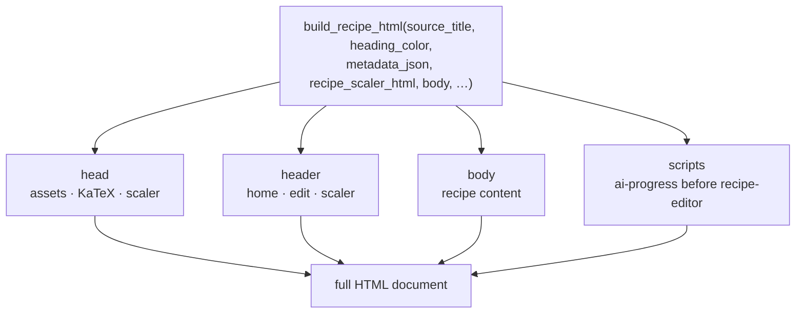

# The page shell (`src/recipeserver/markdown_to_html/page.py`)

Assembles the full HTML document for a recipe page: `<head>` asset references, the header with home/edit buttons and the recipe scaler, and the `<script>` block at the end of `<body>`.

## Key contents

- Asset path constants (`CSS_PATH`, `RECIPE_JS`, `TIME_JS`, …) — all root-absolute `/assets/...` URLs, which is why generated pages must be served from the site root. `_versioned_assets()` appends a content hash to each (`?v=<sha1>` via `versioned_asset_url` in [_version.py.md](../_version.py.md)), so a rebuilt page never runs a stale cached script or stylesheet (the same treatment the index gives its assets).
- `_katex(...)` — the vendored KaTeX links (`/assets/katex/dist/katex.min.css`, `katex.min.js`, `auto-render.min.js`, `katex-init.js`), content-hashed like every other asset. KaTeX is vendored under `assets/katex/`; there is no JS build step.
- `RECIPE_SCALER_HTML = ASSETS_DIR / "recipe-scaler.html"` — read once at converter setup and passed into `build_recipe_html` (no file I/O during rendering).
- `doc_specific_overrides(heading_color)` — per-page `<style>` setting `--food-color` (with a `prefers-color-scheme: dark` variant computed by [color_utils.py.md](../color_utils.py.md)) and coloring headings and the home/edit icons.
- `HOME_PAGE_ICON_HTML`, `EDIT_RECIPE_HTML` — the header fragment with the notebook icon linking to `/index.html` and the pencil edit button.
- `build_recipe_html(...)` — keyword-only: `source_title`, `heading_color`, `metadata_json`, `recipe_scaler_html`, `body`, `ratings_html`, `comments_html`. The `<script id="recipe-metadata" type="application/json">` tag carries the metadata JSON (see [converter.py.md](converter.py.md)).

`ai-progress.js` loads before `recipe-editor.js` on both recipe pages and the index (enforced by the page templates, not by runtime checks). On recipe pages, `metadata-picker.js` loads before `comments.js` / `ratings.js`, which need the shared dropdown widget for their name fields.

## Related pages

- [converter.py.md](converter.py.md) — calls `build_recipe_html`
- [quantities.py.md](quantities.py.md) — the `.quantity` spans the scaler (loaded via `RECIPE_SCALER_JS`) scales
- [feedback.py.md](feedback.py.md) — the ratings/comments sections embedded here
- [README.md](../README.md) — the package hub
