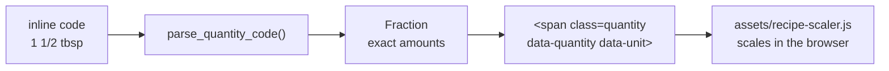

# Inline-code quantities (`src/recipeserver/markdown_to_html/quantities.py`)

Parses inline-code quantities such as `` `1 1/2 tbsp` `` or `` `1-2 cups` `` and rewrites them as `` elements the browser-side recipe scaler (`assets/recipe-scaler.js`) scales.

## Public surface

- `UNIT_ALIASES` — canonicalizes spelled-out units (`tablespoons` → `tbsp`, `grams` → `g`, `ml` → `mL`, …). Units the table does not know pass through unchanged (trimmed).
- `parse_quantity_code(value)` — returns `(start, unit, end_or_None)` for `"1 1/2 cups"`-style mixed numbers, `"1-2 tbsp"`-style ranges (hyphen, en dash, or em dash), plain numbers, and fractions; `None` when unparseable. Amounts go through `Fraction`, so mixed numbers are exact.
- `sanitize_unit(unit)` — the alias lookup above.
- `convert_quantity_code_spans(soup)` — walks every `<code>` in the document and replaces parseable ones with a ``. Unparseable `<code>` is left alone; the HTML linter in [converter.py.md](converter.py.md) flags it in the log.

## Where it is used

[converter.py.md](converter.py.md) — `_postprocess` calls it on the assembled document before writing the page. The data attributes produced here are what [shopping_list.py.md](../shopping_list.py.md) reads to scrape ingredients, and what the scaler JS consumes.

## Notes

- Ranges carry `data-quantity-end`; the shopping list treats those specially (it reports `has_range`).
- Amounts are not converted between units — RecipeServer scales but never converts (a `mL` stays `mL`).

## Related pages

- [converter.py.md](converter.py.md) — pipeline position
- [shopping_list.py.md](../shopping_list.py.md) — scrapes these spans
- [README.md](../README.md) — the package hub
