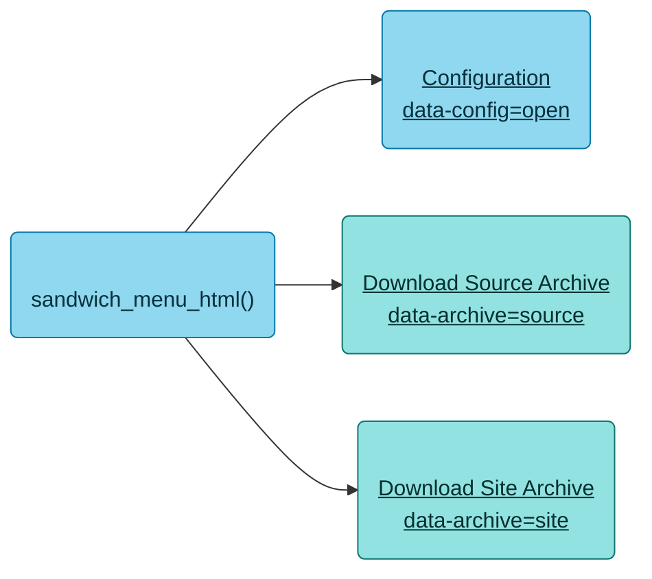

# The sandwich menu (`src/recipeserver/menu.py`)

Reusable hamburger menu markup — deliberately independent of any one page. `sandwich_menu_html()` returns the markup, `MENU_CSS_URL`/`MENU_JS_URL` point at the shared stylesheet and script, and colors come from `definitions.css` so the menu picks up light/dark themes automatically. The index page includes it today; a recipe page can include the same helper to get the identical menu.

## Public surface

- `sandwich_menu_html()` — `<nav class="sandwich-menu">` with a toggle button (`aria-expanded`, `aria-haspopup="menu"`) and a hidden `role="menu"` panel containing three items:
  - **Configuration** — `data-config="open"` (opens the configuration dialog; `assets/config-editor.js` drives it)
  - **Download Source Archive** — `data-archive="source"`
  - **Download Site Archive** — `data-archive="site"`

  Plus a `role="status"` live region for menu feedback. The archive entries hit `/api/archive/source` and `/api/archive/site` ([server.py.md](server.py.md), [archive.py.md](archive.py.md)).

- `MENU_CSS_URL` / `MENU_JS_URL` — content-hashed URLs via `versioned_asset_url` ([_version.py.md](_version.py.md)).
- `_menu_icon_html(icon_path, class_name)` — inlines an asset SVG with `currentColor`-friendly markup and `aria-hidden="true"`.

The menu requires a positioned ancestor (e.g. a `position: relative` page header) for the top-left anchoring in `menu.css`.

## Where it is used

[index_html_generator.py.md](index_html_generator.py.md) (toolbar) today; the recipe page can adopt it by including the helper, `menu.css`, and `menu.js`.

## Related pages

- [archive.py.md](archive.py.md) — what the archive items download
- [index_html_generator.py.md](index_html_generator.py.md) — current consumer
- [README.md](README.md) — the package hub
