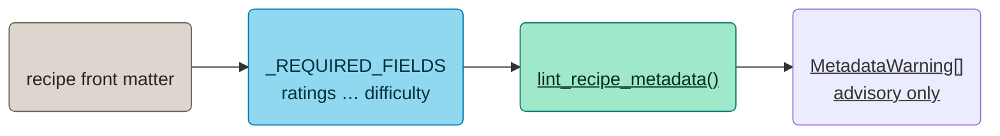

# Metadata linter (`src/recipeserver/metadata_linter.py`)

The required-field list and the warning text behind the index's **Metadata Status** chips. Warnings are advisory: they are logged during conversion, shown in the hidden Metadata Status section of the index, and never block building, serving, or saving.

## Public surface

- `MetadataWarning` — a `TypedDict` with `field`, `label`, `severity` (`"warning"`), and `message` (`Missing <label lowercase>`).
- `_REQUIRED_FIELDS` — `(field, label)` pairs: `ratings`/Ratings, `contributor`/Contributor, `createdOn`/Contribution date, `meals`/Meals, `categories`/Categories, `makes`/Makes, `difficulty`/Difficulty.
- `lint_recipe_metadata(metadata)` — returns one warning per missing required field. A recipe that stores `category` instead of `categories` does not get a spurious `Categories` warning when the legacy value is present (checked via `read_categories` from [recipe_utils.py.md](recipe_utils.py.md)).

"Missing" is defined by `is_missing_metadata_value` ([recipe_utils.py.md](recipe_utils.py.md)): `None`, blank strings, and lists whose items are all missing count as missing.

## Where it is used

[converter.py.md](markdown_to_html/converter.py.md) logs each warning at build time; [index_html_generator.py.md](index_html_generator.py.md) renders them on the recipe cards and in the reviewer-filtered view.

## Related pages

- [recipe_utils.py.md](recipe_utils.py.md) — `is_missing_metadata_value`, `read_categories`
- [index_html_generator.py.md](index_html_generator.py.md) — warning chips
- [README.md](README.md) — the package hub
