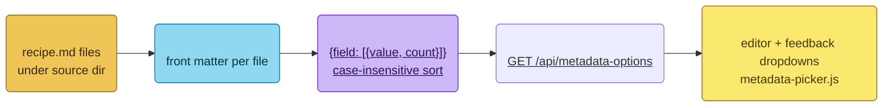

# Metadata options (`src/recipeserver/metadata_options.py`)

Collects the values already used in the recipe library for the dropdowns — meals, categories, cuisine, tags (multi-value) and status, contributor (single-value) for the editor, plus commenters and raters for the feedback forms and source author and title for the editor's source fields — so they can be offered with the number of recipes that use each.

The values are read from the recipe Markdown files on request; they are never hard-coded into generated pages or front matter. The Markdown files stay the source of truth: adding a value to a recipe makes it available to every other recipe right away.

## Public surface

- `MULTI_VALUE_FIELDS = ("meals", "categories", "cuisine", "tags")`, `SINGLE_VALUE_FIELDS = ("status", "contributor")`, `OPTION_FIELDS` — the editor dropdown fields, in order.
- `SOURCE_OPTION_FIELDS` — maps the editor's source dropdown fields (`source.author`, `source.title`) to the key inside the normalized source dict they read (`author`, `title`). The response keys match the pickers' `data-field` values; a legacy list source is coerced the same way the editor reads it (via `normalize_source_dict`).
- `FEEDBACK_OPTION_FIELDS` — maps the feedback name fields (`commenters`, `raters`) to the front matter list they read (`comments`, `ratings`) and the key inside each entry that holds the name (`author`, `name`).
- `collect_metadata_options(source_directory)` — walks `recipe.md` files under the source tree (skipping symlinks), reads front matter, and returns `{field: [{"value": …, "count": n}, …]}` sorted case-insensitively. A recipe counts once per value, even if it repeats it. Legacy singular `category` values count under `categories` (via `read_categories`). Unreadable recipes are logged and skipped. A recipe also counts once per distinct feedback name it carries, compared case-insensitively (via `normalize_reviewer_name`); entries without a name are ignored. Source author and title count once per recipe from the (normalized) source dict; a source that stores a non-string or empty value contributes nothing.

## Where it is used

[server.py.md](server.py.md) `GET /api/metadata-options` serves this directly. The editor widget consumes the response (`assets/recipe-editor/metadata-picker.js`); the feedback forms (`assets/recipe-feedback.js`) consume the `commenters` and `raters` lists the same way; the counts appear next to each option and on the chips.

## Related pages

- [server.py.md](server.py.md) — the endpoint
- [recipe_utils.py.md](recipe_utils.py.md) — `read_categories`, `normalize_reviewer_name`, `normalize_source_dict`
- [README.md](README.md) — the package hub
