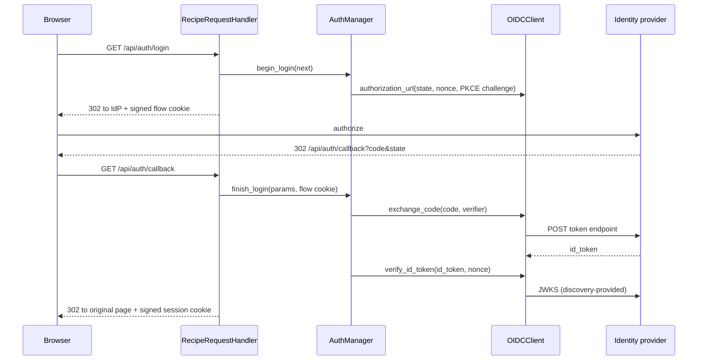

# OIDC flow (`src/recipeserver/oidc.py`)

Provider-agnostic OIDC authorization-code flow. `OIDCClient.discover()` fetches `.well-known/openid-configuration`, checks that the discovery issuer matches the configured issuer, and builds a JWKS client from `jwks_uri`. There is no Pocket ID-specific code.

## Protections

- **PKCE S256**: a fresh verifier per login, with the challenge sent in the authorize request and the verifier in the token exchange.
- **State**: a random value stored inside the signed, expiring flow cookie and compared with `hmac.compare_digest` on the callback. The flow cookie is cleared whether the callback succeeds or fails.
- **Nonce**: generated per login, sent in the authorize request, and compared with the `nonce` claim after verification.
- **ID token**: verified with PyJWT against discovery-provided JWKS (signature, `iss`, `aud`, `exp`, `iat`, `sub` required); a 30-second leeway covers clock skew. Only asymmetric algorithms are accepted.
- **Return URL**: `safe_return_to()` permits only same-origin relative paths, blocking `//host`, absolute URLs, backslashes, CRLF, and `/api/auth/*` loops.

Login flows and sessions are signed cookies rather than server-side state, so no database or in-memory session map is needed (see [session.py.md](session.py.md)). Provider error values are never echoed; failures produce a generic page, while a short, sanitized detail is logged server-side only.
