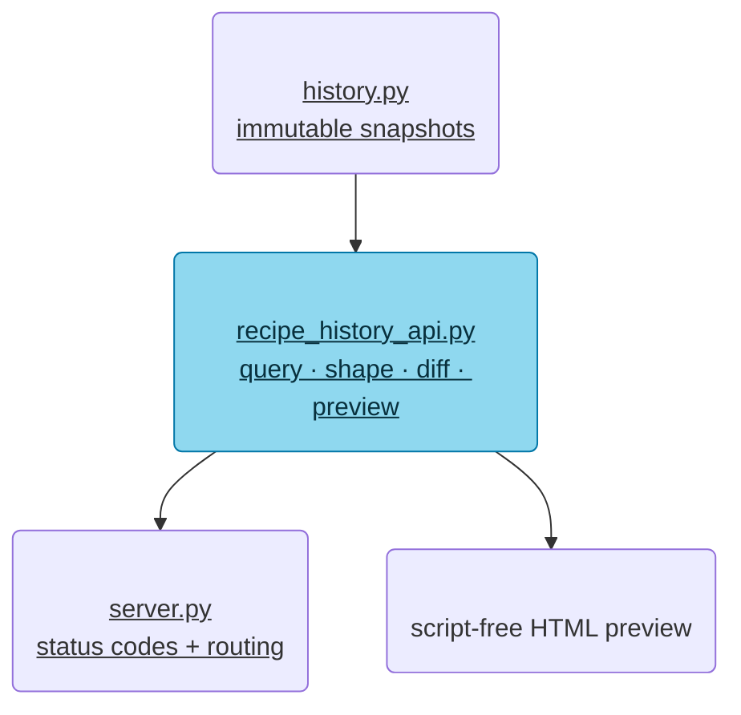

# History API operations (`src/recipeserver/recipe_history_api.py`)

The domain work behind `/api/history/*`. [server.py.md](server.py.md) still
owns routing, parameter validation against the source tree, and status codes;
this module owns the snapshot-store reads, payload shaping, diffing, and the
script-free HTML preview. It needs no request or response object.

## Public interface

- `parse_history_query(query)` — the three optional query parameters.
- `snapshot_payload(recipe_id)` — the dialog's snapshot list.
- `read_snapshot(recipe_id, snapshot_id)` — exact Markdown, raising
  `InvalidSnapshotRequest` (400 in the handler) or `SnapshotNotFound` (404).
- `compare_snapshot(...)` — unified diff plus snapshot metadata.
- `sanitize_preview_html(rendered)` / `render_preview(snapshot, current_recipe)`
  — render a snapshot in a scratch directory, inline the current recipe's
  images as data URIs, strip scripts and page chrome, and never touch the real
  recipe.

## Related pages

- [history.py.md](history.py.md) — the snapshot store
- [retention.py.md](retention.py.md) — pruning and restore locks
- [README.md](README.md) — the package hub
