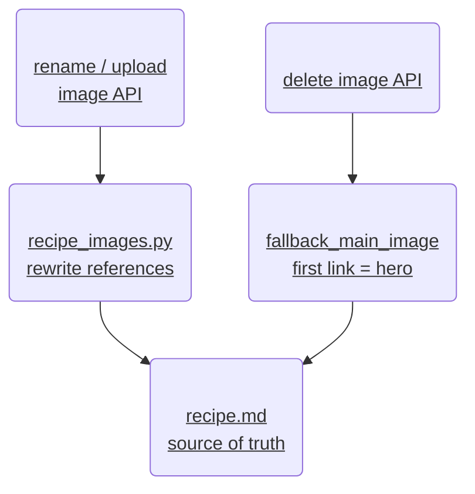

# Image-reference text rules (`src/recipeserver/recipe_images.py`)

The single owner of _editing image links in recipe Markdown_. The HTTP layer
works on the Markdown source (never on generated HTML), and the browser editor
uses the same syntax rules for staged images; a Python/JS parity test keeps the
two in step.

## Public interface

- `image_name_pattern(name)` — match a filename only at a reference boundary,
  so renaming `cake.png` cannot corrupt `chocolate-cake.png`.
- `replace_image_reference(content, source, target)` — rewrite every reference,
  including URL-escaped spellings of the filename.
- `first_image_reference(content)` — locate the first Markdown `` or
  HTML `` link, with its source and span offsets. This is the
  recipe's hero image.
- `basename_of_src(src)` / `is_external_src(src)` — strip query, fragment, and
  HTML entities from a reference, and tell remote URLs from library images.
- `remove_image_span(content, start, end)` — remove a link, dropping its whole
  line when the link was alone there.
- `fallback_main_image(content, deleted_name, remaining_names)` — repoint the
  hero at the first remaining name after a delete, or remove the dangling link;
  returns `(content, new_name)` or `(None, None)` when nothing changed.

The same module validates uploaded image names and content:
`validate_image_filename`, `validate_image_name`, `validate_image_content`, and
`validate_svg_content` (SVG scripts, event handlers, and external references
are rejected). Those are file rules, so they sit with the reference rules
rather than in the HTTP handler.

## Callers

[server.py.md](server.py.md) uses these helpers in the rename, upload, and
delete endpoints. `test/test_image_reference_parity.py` checks that the first
image seen by Python matches the one the editor sees in the browser.

## Related pages

- [recipe_paths.py.md](recipe_paths.py.md) — the other Markdown/source-tree owner
- [image_handler.py.md](image_handler.py.md) — the file-level image set and hero color
- [README.md](README.md) — the package hub
