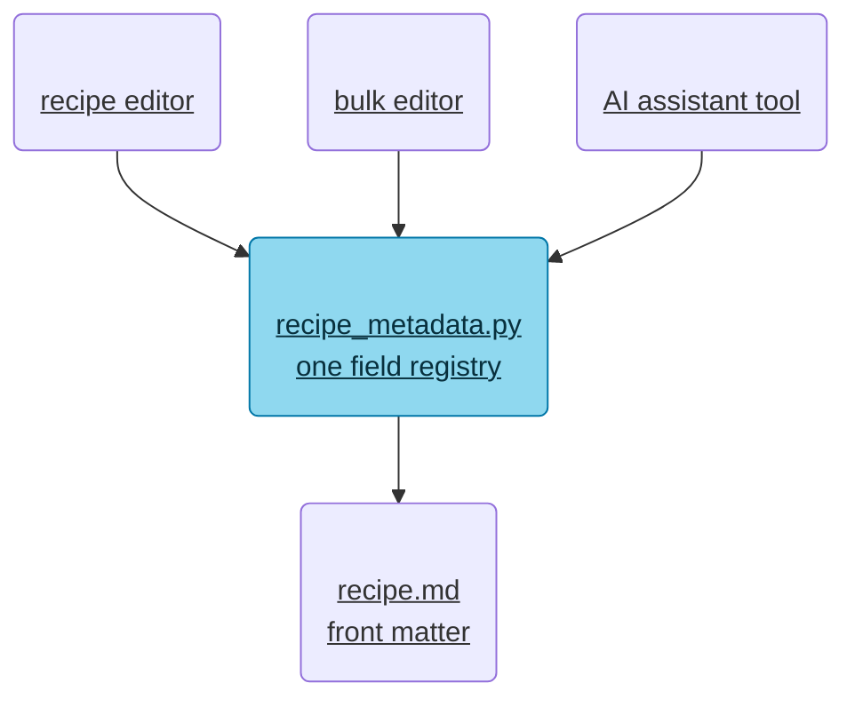

# Recipe front-matter schema (`src/recipeserver/recipe_metadata.py`)

One registry — `EDITOR_METADATA_FIELDS` — defines which front-matter fields the
editor, the per-field API, the bulk editor, and the assistant may write, and
what type each accepts. The validators live in this module rather than in the
HTTP handler, so a rule change reaches every caller at once.

## Public interface

- `EDITOR_METADATA_FIELDS` — field name → value kind (`string_list`, `string`,
  `number`, `boolean`, `non_negative_integer`, `object`).
- `BULK_EDITABLE_FIELDS` — the registry minus the server-managed `updatedOn`.
- `validate_editor_metadata(metadata)` — validate a complete editor payload;
  `validate_assistant_metadata(metadata)` — validate the partial payload a
  model sends, rejecting unknown keys and `updatedOn`.
- `validate_editor_field(field, expected_type, value)` and the per-type
  validators used by the per-field metadata endpoint.
- `editor_metadata(metadata)` — read-side projection for the editor: folds the
  legacy singular `category` into `categories`, collapses `status`, normalizes
  `source`, and defaults `archived` to false.
- `apply_editor_metadata(existing, values)` and `apply_source_metadata(...)` —
  write validated values back while preserving extra legacy sources.
- `canonical_category_field(name)` / `metadata_field_name(path)` /
  `drop_legacy_category(metadata)` — the read/write normalization of the
  legacy `category` spelling.

The same module owns the `ratings` list rules: `validate_ratings`,
`validate_bulk_rating`, and `apply_rating_override` (which reuses an existing
entry's id when the same reviewer rates again). The UTC timestamp writer is
`utc_now_iso` in [recipe_utils.py.md](recipe_utils.py.md). Comments and recipe
identity helpers also live there; the text rules for image references live in
[recipe_images.py.md](recipe_images.py.md).

## Related pages

- [server.py.md](server.py.md) — the endpoints that call these validators
- [recipe_utils.py.md](recipe_utils.py.md) — the lower-level metadata helpers
- [README.md](README.md) — the package hub
