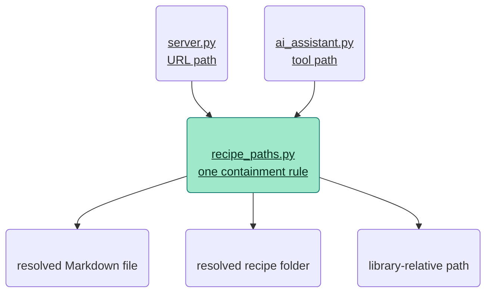

# The library path rules (`src/recipeserver/recipe_paths.py`)

The single owner of _where a recipe lives_. Every path that comes from a URL
query, a bulk-editor payload, a model tool call, or the folder picker is
resolved through these rules, so containment checks cannot drift between the
browser API and the assistant.

## Public interface

- `RECIPE_FILENAME` — the exact filename that marks a recipe directory (`recipe.md`).
- `MARKDOWN_FILE_SUFFIX` — the accepted suffix for editable/readable paths (`.md`).
- `iter_recipe_files(source_directory)` — every `recipe.md` under the library, sorted and excluding symlinks; the one way the core, metadata options, and assistant discover recipes.
- `resolve_recipe_file(source_directory, requested_path, *, action="edited")` —
  reject empty, non-string, backslash-containing, NUL-containing, absolute,
  `..`-traversing, and non-Markdown paths; resolve the result and confirm it
  still sits under the source directory. Symlink escapes are rejected because
  resolution happens before the containment check. `action` only changes the
  wording of the non-Markdown error ("edit" for browser writes, "read" for the
  assistant's read-only tools).
- `resolve_recipe_folder(source_directory, requested_path)` — the same rules
  for a recipe folder, where an empty path denotes the library root.
- `display_path(source_directory, file_path)` — the library-relative POSIX path
  used in prompts, tool output, and replies.

## Callers

[server.py.md](server.py.md) resolves Markdown paths and recipe folders for the
`/api/*` endpoints; [ai_assistant.py.md](ai_assistant.py.md) resolves the
assistant's read-only `path` argument and renders result paths;
[core.py.md](core.py.md) and [metadata_options.py.md](metadata_options.py.md)
use `RECIPE_FILENAME` when discovering recipes;
[index_html_generator.py.md](index_html_generator.py.md) uses
`MARKDOWN_FILE_SUFFIX` when mapping a generated page back to its source.

Structural tests in `test/test_architecture.py` assert that the literal
constants and duplicated validators do not reappear in those modules.

## Related pages

- [README.md](README.md) — the package hub
- [recipe_utils.py.md](recipe_utils.py.md) — the other shared recipe-domain helpers
