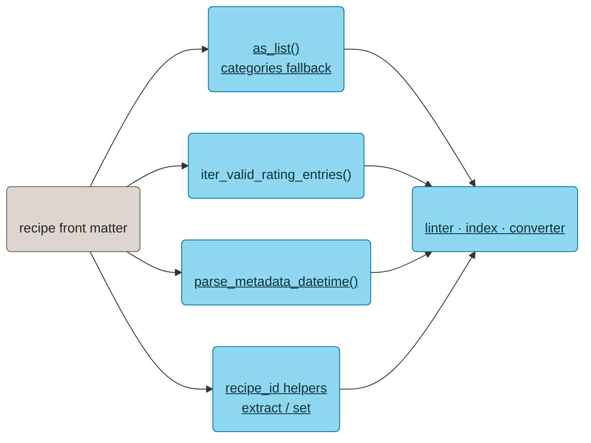

# Shared recipe helpers (`src/recipeserver/recipe_utils.py`)

Small, deliberately narrow helpers shared across the renderers and the server. Kept stable on purpose — add behavior rather than abstraction.

## Metadata reading

- `as_list(value)` — metadata value → list (scalars wrapped, `None` → `[]`).
- `read_categories(metadata)` / `LEGACY_CATEGORY_FIELD` / `CATEGORIES_FIELD` — `categories` with fallback to the legacy singular `category`.
- `normalize_legacy_category(metadata)` — folds `category` into `categories` in place; string values are comma-split. Called on editor saves so the singular field is normalized away.
- `collapse_status(status)` — first non-blank string (unwraps single-item lists).
- `normalize_source_dict(source)` — coerces a legacy list-of-sources to the first dict.
- `clean_source_fields(source, format_labels=None)` — rebuilds `source` with the known `SOURCE_FIELDS` (`author`, `title`, `format`, `url`), trimming strings; optional label normalization via `SOURCE_FORMAT_LABELS` (`website`/`ai`/`book`/`other`).
- `is_missing_metadata_value(value)` — the "does this metadata field carry information" predicate used by the linter and the index.
- `parse_metadata_datetime(value)` — `datetime`/`date`/ISO-8601 strings → timezone-aware UTC `datetime` (`None` when unparseable). `is_date_only(value)` distinguishes calendar dates from timestamps; `display_date(value)` formats for server-rendered fallback text.

## Ratings

- `is_finite_rating_score(score)` — `int`/`float`, not `bool`, finite.
- `iter_valid_rating_entries(ratings)` — yields `(name, score)` for valid dict entries, skipping invalid ones (never raises).
- `normalize_reviewer_name(name)` — NFKC + casefold for case-insensitive comparison.

## Serialization and markup

- `json_default(value)` — `date`/`datetime` → ISO strings for `json.dumps`.
- `meta_time_html(raw_value, text_prefix="")` — the shared `"· <time>"` markup fragment; `<time>` carries `data-local-time` for timestamps and `data-time-prefix` when a prefix is given. Used by [markdown_to_html/extras.py.md](markdown_to_html/extras.py.md) and [index_html_generator.py.md](index_html_generator.py.md).
- `collect_metadata_values(metadata, *keys)` — the one way to read metadata values as stripped, deduplicated strings (scalars count as one value, legacy `category` folds into `categories`). Used by the index filter options and the editor dropdowns.
- `WINDOWS_RESERVED_FILENAMES` / `is_windows_reserved_name(stem)` — the shared device-name rule for recipe folders and image filenames.
- `utc_now_iso()` — current UTC time as a millisecond ISO string ending in `Z`; the one writer for `updatedOn` and rating timestamps.
- `slug_to_title(slug)` — directory-slug → Title Case fallback title.
- `first_heading(text)` — the first level-one Markdown heading outside a fenced code block, or `None`. The renderer, index title fallback, and assistant's `list_recipes` all use this one rule before falling back to front matter or the slug.

## Recipe identity (`recipe_id`)

Every recipe carries a stable UUIDv4 in its front matter as `recipe_id`, assigned automatically — never manually. The helpers work **textually** on the Markdown source (no YAML round-trip), so inserting or replacing the line never reformats the author's front matter; point identity at the file, not the path.

- `RECIPE_ID_FIELD` — the `recipe_id` key.
- `new_recipe_id()` — a fresh UUIDv4 string.
- `is_valid_recipe_id(value)` — True when the value parses as a UUID.
- `canonical_recipe_id(value)` — canonical lower-case spelling (raises `ValueError` otherwise).
- `extract_recipe_id(content)` — the id from the front matter, or `None` (invalid values count as missing).
- `set_recipe_id(content, recipe_id)` — the document with `recipe_id` set: replaces an existing `recipe_id` line in place, inserts after the opening `---`, or prepends a front matter block when the document has none. Everything else is preserved byte-for-byte, including CRLF documents. New recipes get their id injected by the central save mechanism, and existing recipes are migrated in place during `regen()` (see [core.py.md](core.py.md)).

## Related pages

- [metadata_linter.py.md](metadata_linter.py.md) · [metadata_options.py.md](metadata_options.py.md) · [index_html_generator.py.md](index_html_generator.py.md) — consumers
- [README.md](README.md) — the package hub
