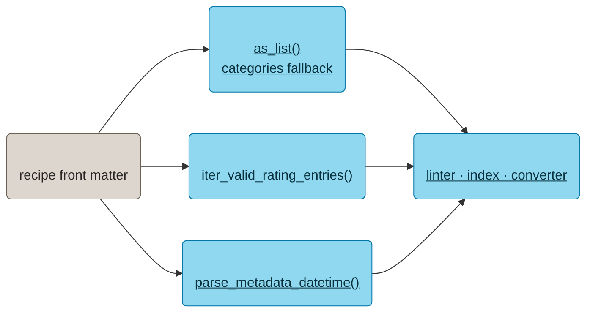

# Shared recipe helpers (`src/recipeserver/recipe_utils.py`)

Small, deliberately narrow helpers shared across the renderers and the server. Kept stable on purpose — add behavior rather than abstraction.

## Metadata reading

- `as_list(value)` — metadata value → list (scalars wrapped, `None` → `[]`).
- `read_categories(metadata)` / `LEGACY_CATEGORY_FIELD` / `CATEGORIES_FIELD` — `categories` with fallback to the legacy singular `category`.
- `normalize_legacy_category(metadata)` — folds `category` into `categories` in place; string values are comma-split. Called on editor saves so the singular field is normalized away.
- `collapse_status(status)` — first non-blank string (unwraps single-item lists).
- `normalize_source_dict(source)` — coerces a legacy list-of-sources to the first dict.
- `clean_source_fields(source, format_labels=None)` — rebuilds `source` with the known `SOURCE_FIELDS` (`author`, `title`, `format`, `url`), trimming strings; optional label normalization via `SOURCE_FORMAT_LABELS` (`website`/`ai`/`book`/`other`).
- `is_missing_metadata_value(value)` — the "does this metadata field carry information" predicate used by the linter and the index.
- `parse_metadata_datetime(value)` — `datetime`/`date`/ISO-8601 strings → timezone-aware UTC `datetime` (`None` when unparseable). `is_date_only(value)` distinguishes calendar dates from timestamps; `display_date(value)` formats for server-rendered fallback text.

## Ratings

- `is_finite_rating_score(score)` — `int`/`float`, not `bool`, finite.
- `iter_valid_rating_entries(ratings)` — yields `(name, score)` for valid dict entries, skipping invalid ones (never raises).
- `normalize_reviewer_name(name)` — NFKC + casefold for case-insensitive comparison.

## Serialization and markup

- `json_default(value)` — `date`/`datetime` → ISO strings for `json.dumps`.
- `meta_time_html(raw_value, text_prefix="")` — the shared `"· <time>"` markup fragment; `<time>` carries `data-local-time` for timestamps and `data-time-prefix` when a prefix is given. Used by [markdown_to_html/extras.py.md](markdown_to_html/extras.py.md) and [index_html_generator.py.md](index_html_generator.py.md).
- `slug_to_title(slug)` — directory-slug → Title Case fallback title.

## Related pages

- [metadata_linter.py.md](metadata_linter.py.md) · [metadata_options.py.md](metadata_options.py.md) · [index_html_generator.py.md](index_html_generator.py.md) — consumers
- [README.md](README.md) — the package hub
