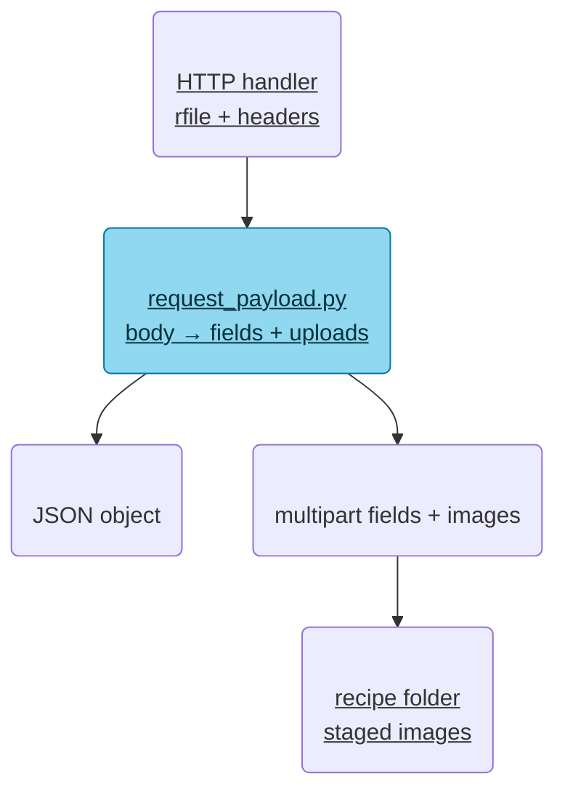

# Request body parsing (`src/recipeserver/request_payload.py`)

The wire-format rules for the editing APIs. The handler passes its binary
stream and headers; this module validates `Content-Length`, decodes JSON or
`multipart/form-data`, normalizes the two payload dialects, and stages uploaded
images. It knows nothing about routes, responses, or status codes.

## Public interface

- `RequestTooLarge` — the shared signal for an oversized body or upload.
- `read_json_payload(rfile, headers, max_size)` — one JSON object, or a
  `ValueError` with a user-facing message.
- `read_ai_recipe_payload(...)` / `read_recipe_payload(...)` — return
  `(fields, images)`; multipart boolean flags (`stream`, `createFolder`) and
  the `metadata` JSON string are normalized here.
- `validate_uploaded_images(images, *, max_count, max_size)` — filenames,
  extensions, content, duplicates, and total size; uses
  [recipe_images.py.md](recipe_images.py.md) for the file rules.
- `write_uploaded_images(directory, images)` — stage files with exclusive
  creation, rolling back partial writes; `remove_uploaded_images(paths)`
  discards them.

The handler supplies its own limits and uses the parsed values; it no longer
implements any of these rules itself.

## Related pages

- [server.py.md](server.py.md) — the endpoints that call these helpers
- [recipe_images.py.md](recipe_images.py.md) — image file and content validation
- [README.md](README.md) — the package hub
