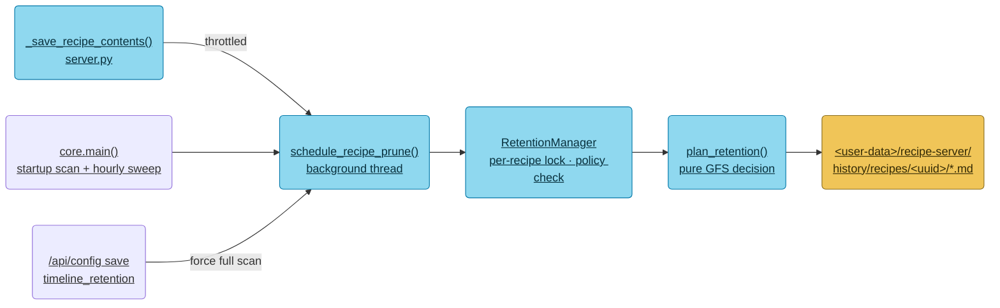

# Timeline revision retention (`src/recipeserver/retention.py`)

Configurable retention for the recipe revision history in [history.py.md](history.py.md), which is otherwise unbounded. The policy vocabulary and the live-value provider contract live in [retention_policy.py.md](retention_policy.py.md); this module owns the GFS schedule and the background executor. Retention is a server-level policy — there is no per-user, per-profile, or per-timeline setting — exposed through the Configuration dialog as **Timeline retention** (`timeline_retention` in `recipe-server-cfg.toml`):

- `gfs` (Grandfather-Father-Son) — the default, for new installations and for installations whose configuration has no `timeline_retention` key. Keeps every revision from the last 24 hours, one revision per hour for the last 7 days, one per day for the last 30 days, one per week (ISO week) for the last 12 months, and one per calendar month older than that.
- `unlimited` — keeps every revision indefinitely, preserving the pre-retention behavior.

Switching policies never resets, migrates, or rewrites history; a switch only changes what the background passes do from then on. Switching to Unlimited stops all future pruning. Switching to GFS starts pruning with the next pass (which happens in the background after the configuration is saved).

## The GFS schedule

`GFS_SCHEDULE` is the single, centralized definition of the tiered schedule — adjust it there and nothing else changes. Tiers are evaluated in order; the first tier whose `max_age` covers the revision's age wins:

| Revision age         | Retention                               |
| -------------------- | --------------------------------------- |
| Last 24 hours        | Every revision                          |
| Last 7 days          | One revision per hour                   |
| Last 30 days         | One revision per day                    |
| Last 12 months       | One revision per week (ISO week)        |
| Older than 12 months | One revision per month (calendar month) |

The algorithm is deterministic and total:

- The newest revision of a timeline is always kept.
- A revision competes only for its own interval's slot; the newest revision in each interval is kept as the most representative of that interval.
- A non-empty timeline always keeps at least its newest revision, and never loses its only remaining revision.
- Revisions with a future timestamp (clock skew) fall into the keep-everything tier.
- A revision's authoritative age comes from the UTC timestamp embedded in its snapshot identifier (`parse_snapshot_id`), never from file mtimes or filename ordering.

`plan_retention(snapshots, now=None)` is a pure function returning the set of snapshot ids to prune; the `now` argument makes age boundaries deterministic under test.

## Background execution

`RetentionManager` runs retention outside HTTP requests. A process-wide instance lives behind `get_retention_manager()`; startup ([core.py.md](core.py.md) `main()`) calls `configure(cfg)` and `start()`, which begins the periodic sweep and requests an initial scan. Retention also runs after each recipe save (throttled to at most one pass per recipe per five minutes) and after every configuration save (forced, in the background).

Properties of the executor:

- Passes never run inside a request handler; they run on daemon threads.
- A per-recipe lock avoids concurrent pruning of the same timeline, and `POST /api/history/restore` holds the same lock across the restore, so a restore is never raced by a prune.
- Passes are throttled and safe to interrupt: files are deleted one at a time, and an interrupted or failed pass is simply completed by the next one — pruning is idempotent.
- Missing snapshot files are tolerated (counted as `missing`), and other filesystem errors are logged and counted as `errors` without aborting the rest of the pass.
- Retained snapshots are never modified or renamed — pruning only deletes whole, redundant revision files.

`prune_recipe(recipe_id, *, now=None)` and `prune_all(*, now=None)` are synchronous and never raise for filesystem problems; they return a `RetentionOutcome` (`scanned`, `kept`, `pruned`, `missing`, `errors`, `skipped`). Under the Unlimited policy they return immediately with `skipped=True`.

## Guarantees

- The restore path and the history APIs work unchanged; retention only ever removes redundant revisions, and never edits any snapshot.
- Switching from Unlimited to GFS does not delete anything at switch time; the history is pruned only by a subsequent safe retention pass.
- Existing snapshots, identifiers, and the restore flow are fully compatible — GFS needs no migration of stored revisions.
- New installations and existing installations both default to GFS.

## Related pages

- [history.py.md](history.py.md) — the snapshot store retention operates on
- [config.py.md](config.py.md) — the `timeline_retention` setting and the GFS/Unlimited dropdown
- [server.py.md](server.py.md) — the per-save hook and the restore lock
- [core.py.md](core.py.md) — startup wiring and the periodic sweep
- [README.md](README.md) — the package hub
