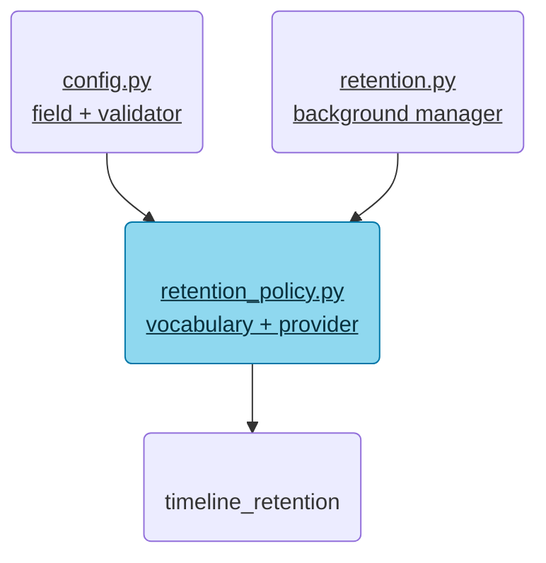

# Retention policy contract (`src/recipeserver/retention_policy.py`)

A leaf module: the vocabulary of timeline retention policies and the contract
for reading the configured value. Both [config.py.md](config.py.md) and
[retention.py.md](retention.py.md) depend on it; neither imports the other.
`test/test_architecture.py` enforces that direction.

## Public interface

- `RETENTION_POLICY_GFS`, `RETENTION_POLICY_UNLIMITED`, `RETENTION_POLICIES`,
  `DEFAULT_RETENTION_POLICY`, `RETENTION_POLICY_LABELS` — the policy names,
  default, order, and configuration labels.
- `normalize_retention_policy(value)` — coerce a config value to a known
  policy, falling back to GFS with a warning.
- `policy_provider(config)` — return a zero-argument reader of the live
  `timeline_retention` attribute. The reader is duck-typed, so the manager
  polls the configuration without depending on its class.

The GFS schedule and the background executor remain in
[retention.py.md](retention.py.md); this module only defines the shared policy
contract.

## Related pages

- [retention.py.md](retention.py.md) — the schedule and executor
- [config.py.md](config.py.md) — the configuration field
- [README.md](README.md) — the package hub
