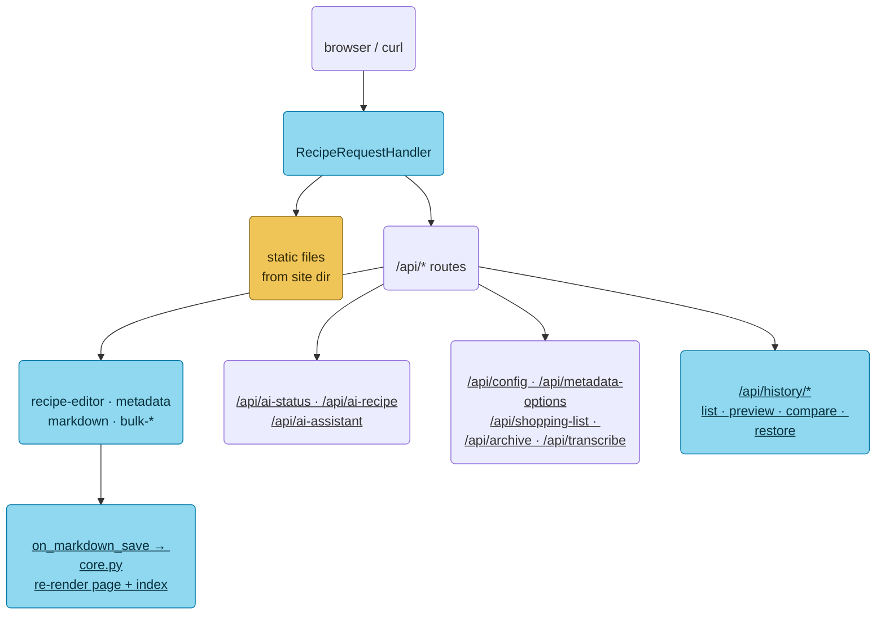

# The HTTP server (`src/recipeserver/server.py`)

`ThreadingHTTPServer` serving the generated site plus the JSON editing APIs. The handler (`RecipeRequestHandler`, a `SimpleHTTPRequestHandler`) serves static files out of the site directory and dispatches `/api/*` routes; the `Server` wrapper owns the thread lifecycle. There is no authentication — the server binds `127.0.0.1` on the configured port (default 8000) and is meant to be reached from this machine, usually through a local reverse proxy that terminates HTTPS.

## `Server`

`__init__(cfg, on_markdown_saved=None, on_config_saved=None, on_recipes_deleted=None)`. `start()` checks the port is free (`_port_in_use`); if it is not, it logs an error and `sys.exit(1)`. Otherwise it binds `SERVER_BIND_ADDRESS = "127.0.0.1"`, serves from `cfg.site_directory`, and runs `serve_forever()` on a daemon thread named `RecipeServer`. `stop()` calls `shutdown()`/`server_close()` and joins. `is_running` reports whether the thread is alive; `port` reads `cfg.server_port`.

`127.0.0.1` is used instead of `0.0.0.0` and `localhost`: the site has no authentication, so it stays on the loopback interface, and the name `localhost` may resolve to IPv6 first, which the server does not listen on. The site is served over HTTPS by a local reverse proxy (or tunnel) that forwards to `http://127.0.0.1:<port>`; that proxy is what makes the dictation button available (see below).

## Routes

| Method   | Path                                       | Handler                                                                                                                                              |
| -------- | ------------------------------------------ | ---------------------------------------------------------------------------------------------------------------------------------------------------- |
| GET      | `/health`                                  | health check                                                                                                                                         |
| GET      | `/api/ai-status`                           | AI configured/reachable probe; also reports `dictation_enabled` ([ai_recipe.py.md](ai_recipe.py.md))                                                 |
| GET      | `/api/config`                              | current configuration values + field specs                                                                                                           |
| POST     | `/api/config`                              | validate + persist configuration; triggers full rebuild                                                                                              |
| GET      | `/api/recipe-folders`                      | list folders under the source directory                                                                                                              |
| GET      | `/api/metadata-options`                    | in-use metadata values and feedback names with counts ([metadata_options.py.md](metadata_options.py.md))                                             |
| GET      | `/api/markdown?path=…`                     | raw Markdown of a recipe                                                                                                                             |
| POST     | `/api/markdown`                            | write raw Markdown back to the recipe file (content only, no front-matter rewrite)                                                                   |
| GET/POST | `/api/recipe-editor?path=…`                | load/save the editor form (save updates `updatedOn`)                                                                                                 |
| GET/POST | `/api/metadata/<field>?path=…`             | per-field metadata read/save                                                                                                                         |
| GET      | `/api/shopping-list?path=…`                | ingredients per selected recipe ([shopping_list.py.md](shopping_list.py.md))                                                                         |
| GET      | `/api/bulk-editor?path=…`                  | metadata for several recipes at once                                                                                                                 |
| POST     | `/api/bulk-editor`                         | apply fields to several recipes                                                                                                                      |
| POST     | `/api/bulk-delete`                         | delete several recipes                                                                                                                               |
| DELETE   | `/api/recipe?path=…`                       | delete one recipe                                                                                                                                    |
| POST     | `/api/recipe`                              | create a recipe in an existing/new folder                                                                                                            |
| POST     | `/api/ai-recipe`                           | draft a recipe (SSE `text/event-stream` when `stream: true`)                                                                                         |
| POST     | `/api/ai-assistant`                        | chat with the local model; `path` binds the editable recipe (SSE `text/event-stream` when `stream: true`) ([ai_assistant.py.md](ai_assistant.py.md)) |
| POST     | `/api/transcribe`                          | transcribe a recorded clip ([transcriber.py.md](transcriber.py.md))                                                                                  |
| POST     | `/api/recipe-images/upload`                | upload images next to a recipe                                                                                                                       |
| POST     | `/api/recipe-images/rename`                | rename an image; rewrites Markdown references                                                                                                        |
| POST     | `/api/recipe-images/delete`                | delete an image; main-image fallback logic                                                                                                           |
| GET      | `/api/history?path=…`                      | list a recipe's snapshots (newest first); `recipeId` is accepted when the file is gone (deleted recipe)                                              |
| GET      | `/api/history/preview?path=…&snapshot=…`   | render the snapshot through the recipe pipeline (scripts stripped) as `text/html` for the history dialog's preview frame                             |
| GET      | `/api/history/compare?path=…&snapshot=…`   | a unified diff (`snapshot` → `current`) for the history dialog                                                                                       |
| POST     | `/api/history/restore`                     | restore a snapshot; snapshots the current recipe first so the restore is reversible (`{"path", "snapshot", "recipeId"?}`)                            |
| GET      | `/api/archive/source`, `/api/archive/site` | stream a 7z archive ([archive.py.md](archive.py.md))                                                                                                 |

Unknown `/api/*` paths return 404. `path` must be a relative `.md` path inside the configured source directory; anything else is rejected.

## Response headers

HTML responses (generated `.html` pages and directory paths) are sent with `Cache-Control: no-store` so a browser reload right after a save always shows the freshly generated page — the static-file fallback sends no caching headers and browsers apply heuristic caching otherwise. JSON API responses also send `no-store`; vendored KaTeX and other assets keep the static-file defaults.

## Version history and the common save mechanism

Every RecipeServer-managed modification of a recipe — editor saves, raw `/api/markdown` writes, per-field metadata saves, bulk edits, assistant edits, image rename/delete reference rewrites, restores — flows through one module-level function, `_save_recipe_contents(path, new_content, …)`, which ([history.py.md](history.py.md)):

1. reads the existing file and computes whether the new content is **equivalent** (byte-equal, or equal after ignoring `updatedOn` and explicit-null editor fields — so a save that changes nothing writes nothing and snapshots nothing);
2. resolves the recipe's `recipe_id` (the existing one, else a fresh UUIDv4 for a new recipe, else the caller-forced id for a deleted-recipe restore) and forces it into the saved content textually — identity never depends on the path;
3. snapshots the existing content into the history directory (raising `history.HistoryError`, which aborts the save, when the snapshot cannot be written);
4. writes the file atomically, rolling the snapshot back only if the write itself failed.

Recipe history endpoints (the recipe page's **Version History** dialog consumes them; see `assets/recipe-history/timeline.js`):

- `GET /api/history?path=…[&recipeId=…]` — `{path, recipeId, snapshots: [{id, created, size}]}`, newest first. A missing recipe file (deleted recipe) needs `recipeId`. A recipe without `recipe_id` is assigned one in place (no snapshot).
- `GET /api/history/preview?path=…&snapshot=…` — renders the snapshot through the same `MarkdownToHTMLConverter` pipeline as a scratch copy and returns it as `text/html` with scripts and the page header stripped; the current recipe is untouched.
- `GET /api/history/compare?path=…&snapshot=…` — a unified diff (`snapshot` → `current`) for read-only comparison.
- `POST /api/history/restore` `{path, snapshot[, recipeId]}` — snapshots the current recipe first (so the restore is itself reversible), then writes the snapshot content back, forcing the current recipe's identity. For a deleted recipe (no file), passing `path` + `recipeId` recreates the file and its parent directories — this is the supported recovery path.

Deleting a recipe never touches the history directory; metadata saves make snapshots of the pre-change file exactly as editor saves do.

## Speech transcription

`POST /api/transcribe` takes the raw audio of a recording and returns `{"text": "…"}`.

- The feature can be turned off with the **Dictation** field in the configuration ([config.py.md](config.py.md)). When dictation is disabled the endpoint answers 403, the generated index pages do not render the button ([index_html_generator.py.md](index_html_generator.py.md)), and a running whisper-server is stopped on the configuration save.
- The request must have arrived over HTTPS. The server itself speaks plain HTTP, so the protocol is taken from the `X-Forwarded-Proto` (or `Forwarded`) header the reverse proxy sets; without it the endpoint answers 403. The header can only come from a local process, because the server listens on the loopback interface only.
- The body is the recording; its `Content-Type` selects the container (`audio/webm`, `audio/ogg`, `audio/mp4`, `audio/wav`, `audio/mpeg`) and the suffix the recording is written to. Unknown types answer 415, an empty body 400, and a body over `MAX_TRANSCRIPTION_SIZE` 413.
- The recording is decoded with PyAV into a 16 kHz mono WAV and posted to the locally managed [whisper-server](whisper_server.py.md) ([fordaj/whisper-native](https://github.com/fordaj/whisper-native)); the managed process is started on the first transcription and stopped on app shutdown. A missing binary or model answers 503 and a recording that cannot be decoded answers 400 with the reason; anything else is a 500.

## The AI assistant

`POST /api/ai-assistant` powers the floating bubble on every page.

- The request body is `{message, history?, path?, stream?}`: `message` is a non-empty string capped at 4000 characters, `history` is clamped to the last 20 `user`/`assistant` turns, `path` is the recipe being viewed (rejected with 404 when missing, 400 when invalid), and `stream: true` answers `text/event-stream` instead of plain JSON.
- Without `path` (the index page) the model is offered only the read tools; a `path` enables `update_current_recipe`, whose edits are bound server-side to the one recipe being viewed — there is no delete tool and no bulk edit anywhere.
- The stream mirrors `/api/ai-recipe`: `status` (`state` + `message`), `metrics`, `error` (`state` + `message`) and `result` (`result`: `{reply, edited, path, metrics}`). Without `stream`, the endpoint returns the same object as JSON. Agent details (tool schemas, loop cap, fallback for non-tool models) live in [ai_assistant.py.md](ai_assistant.py.md).
- When the assistant edits the recipe, the handler rewrites `recipe.md` through the same front-matter pipeline as the manual editor (editor-fields-only `metadata`, `updatedOn` refreshed) and regenerates that page plus the index; the browser then offers a Reload button.
- Errors map like the other AI endpoints: 503 when the model is not configured or unreachable, 502 on model/endpoint failures, 400 on invalid input, 404 for an unknown `path`.
- `GET /api/ai-status` additionally reports `dictation_enabled` (from `_dictation_enabled`), which the bubble reads to decide whether a long press starts dictation. On plain HTTP, or when dictation is disabled, a long press degrades to a normal tap.

## Limits and conventions

- `MAX_REQUEST_SIZE` 5 MiB; `MAX_IMAGE_UPLOAD_SIZE` 25 MiB; `MAX_IMAGE_UPLOAD_COUNT` 20; `MAX_TRANSCRIPTION_SIZE` 25 MiB; `BULK_MAX_PATHS` 100.
- Recipe files are always `recipe.md`; uploaded image names are validated (`_validate_image_name`, SVG content screened for `script`/`foreignobject`).
- Saves notify the callbacks: `on_markdown_save` for Markdown/editor saves (re-render page + index), `on_config_save` for configuration (full rebuild), `on_recipes_deleted` for deletes. Saves whose content is unchanged skip the write and the callback entirely. A full editor save rewrites `recipe.md` through python-frontmatter and updates `updatedOn`; the per-field metadata endpoint does not. Every save goes through the common save mechanism above, which snapshots the replaced version into the recipe's history first.
- Request bodies are read with size caps (`_read_body`); multipart is parsed with the stdlib `email` parser (`_parse_multipart_message`).

## Related pages

- [core.py.md](core.py.md) — wires the callbacks
- [history.py.md](history.py.md) — the snapshot store and the history directory
- [ai_recipe.py.md](ai_recipe.py.md) · [ai_assistant.py.md](ai_assistant.py.md) · [archive.py.md](archive.py.md) · [metadata_options.py.md](metadata_options.py.md) · [shopping_list.py.md](shopping_list.py.md) · [transcriber.py.md](transcriber.py.md) · [whisper_server.py.md](whisper_server.py.md) — backing modules
- [README.md](README.md) — the package hub
