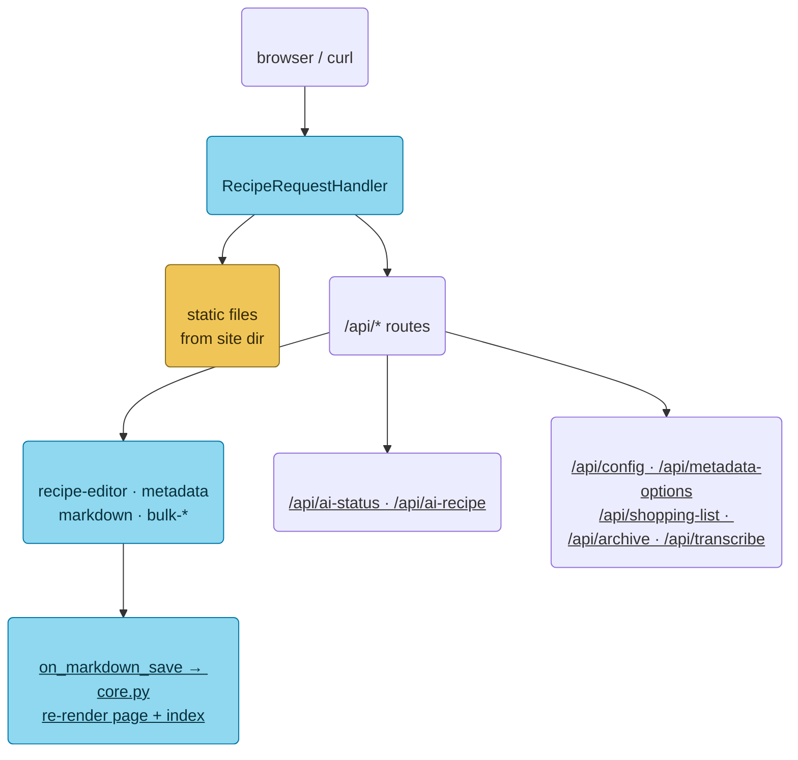

# The HTTP server (`src/recipeserver/server.py`)

`ThreadingHTTPServer` serving the generated site plus the JSON editing APIs. The handler (`RecipeRequestHandler`, a `SimpleHTTPRequestHandler`) serves static files out of the site directory and dispatches `/api/*` routes; the `Server` wrapper owns the thread lifecycle. There is no authentication — the server binds `127.0.0.1` on the configured port (default 8000) and is meant to be reached from this machine, usually through a local reverse proxy that terminates HTTPS.

## `Server`

`__init__(cfg, on_markdown_saved=None, on_config_saved=None, on_recipes_deleted=None)`. `start()` checks the port is free (`_port_in_use`); if it is not, it logs an error and `sys.exit(1)`. Otherwise it binds `SERVER_BIND_ADDRESS = "127.0.0.1"`, serves from `cfg.site_directory`, and runs `serve_forever()` on a daemon thread named `RecipeServer`. `stop()` calls `shutdown()`/`server_close()` and joins. `is_running` reports whether the thread is alive; `port` reads `cfg.server_port`.

`127.0.0.1` is used instead of `0.0.0.0` and `localhost`: the site has no authentication, so it stays on the loopback interface, and the name `localhost` may resolve to IPv6 first, which the server does not listen on. The site is served over HTTPS by a local reverse proxy (or tunnel) that forwards to `http://127.0.0.1:<port>`; that proxy is what makes the dictation button available (see below).

## Routes

| Method   | Path                                       | Handler                                                                                                  |
| -------- | ------------------------------------------ | -------------------------------------------------------------------------------------------------------- |
| GET      | `/health`                                  | health check                                                                                             |
| GET      | `/api/ai-status`                           | AI configured/reachable probe ([ai_recipe.py.md](ai_recipe.py.md))                                       |
| GET      | `/api/config`                              | current configuration values + field specs                                                               |
| POST     | `/api/config`                              | validate + persist configuration; triggers full rebuild                                                  |
| GET      | `/api/recipe-folders`                      | list folders under the source directory                                                                  |
| GET      | `/api/metadata-options`                    | in-use metadata values and feedback names with counts ([metadata_options.py.md](metadata_options.py.md)) |
| GET      | `/api/markdown?path=…`                     | raw Markdown of a recipe                                                                                 |
| POST     | `/api/markdown`                            | write raw Markdown back to the recipe file (content only, no front-matter rewrite)                       |
| GET/POST | `/api/recipe-editor?path=…`                | load/save the editor form (save updates `updatedOn`)                                                     |
| GET/POST | `/api/metadata/<field>?path=…`             | per-field metadata read/save                                                                             |
| GET      | `/api/shopping-list?path=…`                | ingredients per selected recipe ([shopping_list.py.md](shopping_list.py.md))                             |
| GET      | `/api/bulk-editor?path=…`                  | metadata for several recipes at once                                                                     |
| POST     | `/api/bulk-editor`                         | apply fields to several recipes                                                                          |
| POST     | `/api/bulk-delete`                         | delete several recipes                                                                                   |
| DELETE   | `/api/recipe?path=…`                       | delete one recipe                                                                                        |
| POST     | `/api/recipe`                              | create a recipe in an existing/new folder                                                                |
| POST     | `/api/ai-recipe`                           | draft a recipe (SSE `text/event-stream` when `stream: true`)                                             |
| POST     | `/api/transcribe`                          | transcribe a recorded clip ([transcriber.py.md](transcriber.py.md))                                      |
| POST     | `/api/recipe-images/upload`                | upload images next to a recipe                                                                           |
| POST     | `/api/recipe-images/rename`                | rename an image; rewrites Markdown references                                                            |
| POST     | `/api/recipe-images/delete`                | delete an image; main-image fallback logic                                                               |
| GET      | `/api/archive/source`, `/api/archive/site` | stream a 7z archive ([archive.py.md](archive.py.md))                                                     |

Unknown `/api/*` paths return 404. `path` must be a relative `.md` path inside the configured source directory; anything else is rejected.

## Response headers

HTML responses (generated `.html` pages and directory paths) are sent with `Cache-Control: no-store` so a browser reload right after a save always shows the freshly generated page — the static-file fallback sends no caching headers and browsers apply heuristic caching otherwise. JSON API responses also send `no-store`; vendored KaTeX and other assets keep the static-file defaults.

## Speech transcription

`POST /api/transcribe` takes the raw audio of a recording and returns `{"text": "…"}`.

- The request must have arrived over HTTPS. The server itself speaks plain HTTP, so the protocol is taken from the `X-Forwarded-Proto` (or `Forwarded`) header the reverse proxy sets; without it the endpoint answers 403. The header can only come from a local process, because the server listens on the loopback interface only.
- The body is the recording; its `Content-Type` selects the container (`audio/webm`, `audio/ogg`, `audio/mp4`, `audio/wav`, `audio/mpeg`) and the suffix the recording is written to. Unknown types answer 415, an empty body 400, and a body over `MAX_TRANSCRIPTION_SIZE` 413.
- The transcription itself is done by the module-level `transcriber` ([transcriber.py.md](transcriber.py.md)); a missing model answers 503 and a failed transcription 500.

## Limits and conventions

- `MAX_REQUEST_SIZE` 5 MiB; `MAX_IMAGE_UPLOAD_SIZE` 25 MiB; `MAX_IMAGE_UPLOAD_COUNT` 20; `MAX_TRANSCRIPTION_SIZE` 25 MiB; `BULK_MAX_PATHS` 100.
- Recipe files are always `recipe.md`; uploaded image names are validated (`_validate_image_name`, SVG content screened for `script`/`foreignobject`).
- Saves notify the callbacks: `on_markdown_save` for Markdown/editor saves (re-render page + index), `on_config_save` for configuration (full rebuild), `on_recipes_deleted` for deletes. A full editor save rewrites `recipe.md` through python-frontmatter and updates `updatedOn`; the per-field metadata endpoint does not.
- Request bodies are read with size caps (`_read_body`); multipart is parsed with the stdlib `email` parser (`_parse_multipart_message`).

## Related pages

- [core.py.md](core.py.md) — wires the callbacks
- [ai_recipe.py.md](ai_recipe.py.md) · [archive.py.md](archive.py.md) · [metadata_options.py.md](metadata_options.py.md) · [shopping_list.py.md](shopping_list.py.md) · [transcriber.py.md](transcriber.py.md) — backing modules
- [README.md](README.md) — the package hub
