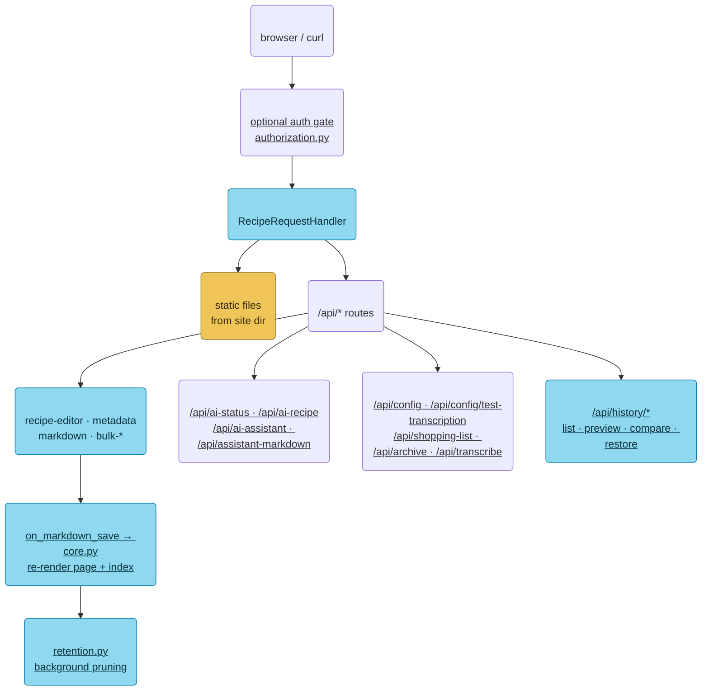

# The HTTP server (`src/recipeserver/server.py`)

`ThreadingHTTPServer` serving the generated site plus the JSON editing APIs. The handler (`RecipeRequestHandler`, a `SimpleHTTPRequestHandler`) serves static files out of the site directory and dispatches `/api/*` routes; the `Server` wrapper owns the thread lifecycle. Authentication is optional and off by default — the server binds `0.0.0.0` by default on the configured port (default 8000), which makes the site reachable on the local network from next start; `server_bind_address = "127.0.0.1"` restricts it to this machine. When OIDC is enabled, every request first passes through the central gate in [authorization.py.md](authorization.py.md), including generated pages and `HEAD` requests.

The server classes (`_RecipeThreadingHTTPServer`, and its IPv6 subclass `_ThreadingHTTPServerIPv6`) set `request_queue_size = LISTEN_BACKLOG` (128) instead of the `socketserver` default of 5: Windows answers a connection that arrives with a full listen backlog with an explicit reset (`WSAECONNREFUSED`) instead of silently dropping the SYN for the client to retransmit as Linux and macOS do, which turned a burst of upstream connections from a reverse proxy into intermittent 502 Bad Gateway for the page's assets.

`end_headers` never trusts `self.path` to exist — it does not when an error response is issued before the request line was parsed (any byte sequence the parser rejects, such as a client speaking TLS at this plain-HTTP port). Without that guard the connection closed with zero response bytes, which a proxy in front turns into 502 Bad Gateway; the client now gets the (HTTP/0.9-style, body-only) `400` error response instead.

## `Server`

`__init__(cfg, on_markdown_saved=None, on_config_saved=None, on_recipes_deleted=None, auth=None)`. `start()` checks the port is free (`_port_in_use`, probing loopback for a wildcard bind); if it is not, it logs an error and `sys.exit(1)`. Otherwise it binds the configured `server_bind_address` (an IP literal, `0.0.0.0` by default; a `:` in the literal selects an IPv6 socket via `_ThreadingHTTPServerIPv6`, which subclasses the same backlog-enlarged base `_RecipeThreadingHTTPServer` used for IPv4), serves from `cfg.site_directory`, and runs `serve_forever()` on a daemon thread named `RecipeServer`. A startup warning is logged whenever the bind is not loopback, because the site has no authentication. `stop()` calls `shutdown()`/`server_close()` and joins. `is_running` reports whether the thread is alive; `port` reads `cfg.server_port` and `bind_address` reads `cfg.server_bind_address`.

`0.0.0.0` is the default (the maintainer's explicit choice): the site is reachable from the local network, including as `<hostname>.local:8000`, knowing it has no authentication. `127.0.0.1` (loopback-only) is the recommended setting when using a reverse proxy for remote access — the name `localhost` is still not accepted, because it may resolve to IPv6 first. The site is served over HTTPS by a local reverse proxy (or tunnel) that forwards to `http://127.0.0.1:<port>`; that proxy is what makes the dictation button available (see below).

## Authentication gate

When an `AuthManager` is supplied, `do_GET`, `do_HEAD`, `do_POST`, and `do_DELETE` call `_auth_gate()` before any dispatch. Static files fall through to `SimpleHTTPRequestHandler`, so covering `HEAD` as well as `GET` is essential; `/assets/*` and `/health` remain public so the sign-in UI and its icons can load. Insufficient permission for an anonymous caller redirects to login for pages and answers JSON 401 with a `loginUrl` for `/api/*`; an authenticated caller gets 403. Mutations additionally require the `X-CSRF-Token` header (for signed-in callers) and an acceptable `Origin`/`Sec-Fetch-Site`; the browser gets that token from `/api/auth/status` and `assets/auth/auth.js` attaches it to same-origin writes automatically. Early gate responses and `POST /api/auth/logout` drain the declared request body (`_discard_request_body`) before replying: with HTTP/1.1 keep-alive, unread bytes such as the logout's `{}` would otherwise prefix the next request line and produce a 501 "Unsupported method ('{}GET')". See [authorization.py.md](authorization.py.md), [session.py.md](session.py.md), and [oidc.py.md](oidc.py.md).

## HTTP protocol

The handler speaks **HTTP/1.1** with keep-alive. (`SimpleHTTPRequestHandler` defaults to HTTP/1.0, which made the browser open a fresh TCP connection for every asset; over a tunnel or relay such as Tailscale that is round-trip-expensive, and a dropped connection lost whichever asset it carried — the symptom ranged from missing stylesheets to raw HTML.) Two consequences matter:

- Every response declares its length. `end_headers` adds an explicit `Content-Length: 0` for responses that sent neither a `Content-Length` nor a `Transfer-Encoding` and cannot be close-delimited — concretely, the bodyless `301` the static handler issues for a directory without a trailing slash — except for `1xx`, `204`, `205`, `304`, and responses marked `Connection: close` (the SSE streams and the 404 generator, which are close-delimited).
- Send `Cache-Control` on everything it can: HTML and directory URLs stay `no-store`; all other static assets (CSS, JS, KaTeX fonts, SVG) get `no-cache`, so they revalidate against the file fallback's `Last-Modified` and come back as cheap 304s instead of whatever the heuristic cache decides — and a rebuilt asset is always picked up. JSON API responses set their own `no-store` (which is left alone).

## Routes

| Method   | Path                                       | Handler                                                                                                                                              |
| -------- | ------------------------------------------ | ---------------------------------------------------------------------------------------------------------------------------------------------------- |
| GET      | `/health`                                  | health check                                                                                                                                         |
| GET      | `/api/auth/status`                         | auth enabled/authenticated/permission/Owner flags and CSRF token (no secrets)                                                                        |
| GET      | `/api/auth/login`                          | start OIDC login; 302 to the provider and set the signed flow cookie                                                                                 |
| GET      | `/api/auth/callback`                       | OIDC callback: validate state/nonce, verify ID token, set the session cookie                                                                         |
| POST     | `/api/auth/logout`                         | clear the session cookie (CSRF token required when signed in)                                                                                        |
| GET/POST | `/api/auth/settings`                       | Owner-only Guest/authenticated permission defaults                                                                                                   |
| GET      | `/api/ai-status`                           | AI configured/reachable probe; also reports `dictation_enabled` ([ai_recipe.py.md](ai_recipe.py.md))                                                 |
| GET      | `/api/config`                              | current configuration values + field specs + per-model probe (`models`) — see below                                                                  |
| POST     | `/api/config`                              | validate + persist configuration; triggers full rebuild                                                                                              |
| POST     | `/api/config/test-transcription`           | verify the configured transcription server/model against the bundled sample                                                                          |
| GET      | `/api/recipe-folders`                      | list folders under the source directory                                                                                                              |
| GET      | `/api/metadata-options`                    | in-use metadata values and feedback names with counts ([metadata_options.py.md](metadata_options.py.md))                                             |
| GET      | `/api/markdown?path=…`                     | raw Markdown of a recipe                                                                                                                             |
| POST     | `/api/markdown`                            | write raw Markdown back to the recipe file (content only, no front-matter rewrite)                                                                   |
| GET/POST | `/api/recipe-editor?path=…`                | load/save the editor form (save updates `updatedOn`)                                                                                                 |
| GET/POST | `/api/metadata/<field>?path=…`             | per-field metadata read/save                                                                                                                         |
| GET      | `/api/shopping-list?path=…`                | ingredients per selected recipe ([shopping_list.py.md](shopping_list.py.md))                                                                         |
| GET      | `/api/bulk-editor?path=…`                  | metadata for several recipes at once                                                                                                                 |
| POST     | `/api/bulk-editor`                         | apply fields to several recipes                                                                                                                      |
| POST     | `/api/bulk-delete`                         | delete several recipes                                                                                                                               |
| DELETE   | `/api/recipe?path=…`                       | delete one recipe                                                                                                                                    |
| POST     | `/api/recipe`                              | create a recipe in an existing/new folder                                                                                                            |
| POST     | `/api/ai-recipe`                           | draft a recipe (SSE `text/event-stream` when `stream: true`)                                                                                         |
| POST     | `/api/ai-assistant`                        | chat with the local model; `path` binds the editable recipe (SSE `text/event-stream` when `stream: true`) ([ai_assistant.py.md](ai_assistant.py.md)) |
| POST     | `/api/assistant-markdown`                  | render a chat message's Markdown to a sanitized HTML fragment ([assistant_render.py.md](assistant_render.py.md))                                     |
| POST     | `/api/transcribe`                          | transcribe a recorded clip ([transcriber.py.md](transcriber.py.md))                                                                                  |
| POST     | `/api/recipe-images/upload`                | upload images next to a recipe                                                                                                                       |
| POST     | `/api/recipe-images/rename`                | rename an image; rewrites Markdown references                                                                                                        |
| POST     | `/api/recipe-images/delete`                | delete an image; main-image fallback logic                                                                                                           |
| GET      | `/api/history?path=…`                      | list a recipe's snapshots (newest first); `recipeId` is accepted when the file is gone (deleted recipe)                                              |
| GET      | `/api/history/preview?path=…&snapshot=…`   | render the snapshot through the recipe pipeline (scripts stripped) as `text/html` for the history dialog's preview frame                             |
| GET      | `/api/history/compare?path=…&snapshot=…`   | a unified diff (`snapshot` → `current`) for the history dialog                                                                                       |
| POST     | `/api/history/restore`                     | restore a snapshot; snapshots the current recipe first so the restore is reversible (`{"path", "snapshot", "recipeId"?}`)                            |
| GET      | `/api/archive/source`, `/api/archive/site` | stream a 7z archive ([archive.py.md](archive.py.md))                                                                                                 |

Unknown `/api/*` paths return 404. `path` must be a relative `.md` path inside the configured source directory; anything else is rejected.

## Configuration probing

`GET /api/config` additionally returns a `models` object alongside `values` and `fields`: one entry per Ollama model the app uses (`all_purpose_model_name` and `image_analysis_model` from the configured `model_endpoint`, `transcription_model` from `transcription_endpoint`). Each entry carries the model's resolved name (a blank configured name is auto-detected exactly like generation does), `present`, on-disk size (`size_bytes` and `size_gb`), `parameter_size`, `quantization_level`, `runner`, `capabilities`, and `can_keep_alive` — whether the model can stay resident, which is `true` only when the server reports an installed model with a non-zero size (remote/cloud models report none). The probes never raise: failures are reported in each entry's `error`, and the Configuration dialog uses them to caption the model fields with their size and to disable the keep-alive field of a model that cannot stay loaded (see [config.py.md](config.py.md)). The probes use `ai_recipe.model_info` with a short timeout; a configured-and-reachable server answers in microseconds.

## Response headers

HTML responses (generated `.html` pages and directory paths) are sent with `Cache-Control: no-store` so a browser reload right after a save always shows the freshly generated page — the static-file fallback sends no caching headers and browsers apply heuristic caching otherwise. All other static assets are sent with `Cache-Control: no-cache` (revalidate every load; the file fallback supports `If-Modified-Since`, so revalidation is a cheap 304). JSON API responses also send `no-store`, and `end_headers` never overrides a `Cache-Control` already set by the handler. Every response carries a `Content-Length` or is explicitly close-delimited, as required for HTTP/1.1 keep-alive (see [HTTP protocol](#http-protocol)).

## Version history and the common save mechanism

Every RecipeServer-managed modification of a recipe — editor saves, raw `/api/markdown` writes, per-field metadata saves, bulk edits, assistant edits, image rename/delete reference rewrites, restores — flows through one module-level function, `_save_recipe_contents(path, new_content, …)`, which ([history.py.md](history.py.md)):

1. reads the existing file and computes whether the new content is **equivalent** (byte-equal, or equal after ignoring `updatedOn` and explicit-null editor fields — so a save that changes nothing writes nothing and snapshots nothing);
2. resolves the recipe's `recipe_id` (the existing one, else a fresh UUIDv4 for a new recipe, else the caller-forced id for a deleted-recipe restore) and forces it into the saved content textually — identity never depends on the path;
3. snapshots the existing content into the history directory (raising `history.HistoryError`, which aborts the save, when the snapshot cannot be written);
4. writes the file atomically, rolling the snapshot back only if the write itself failed;
5. schedules a throttled background prune of that recipe's history ([retention.py.md](retention.py.md)), which never blocks the save.

Recipe history endpoints (the recipe page's **Version History** dialog consumes them; see `assets/recipe-history/timeline.js`):

- `GET /api/history?path=…[&recipeId=…]` — `{path, recipeId, snapshots: [{id, created, size}]}`, newest first. A missing recipe file (deleted recipe) needs `recipeId`. A recipe without `recipe_id` is assigned one in place (no snapshot).
- `GET /api/history/preview?path=…&snapshot=…` — renders the snapshot through the same `MarkdownToHTMLConverter` pipeline as a scratch copy and returns it as `text/html` with scripts and the page header stripped; the current recipe is untouched.
- `GET /api/history/compare?path=…&snapshot=…` — a unified diff (`snapshot` → `current`) for read-only comparison.
- `POST /api/history/restore` `{path, snapshot[, recipeId]}` — snapshots the current recipe first (so the restore is itself reversible), then writes the snapshot content back, forcing the current recipe's identity. For a deleted recipe (no file), passing `path` + `recipeId` recreates the file and its parent directories — this is the supported recovery path. The handler holds the per-recipe retention lock across the read and the write, so a background prune can never delete the snapshot mid-restore.

Deleting a recipe never touches the history directory; metadata saves make snapshots of the pre-change file exactly as editor saves do.

## Speech transcription

`POST /api/transcribe` takes the raw audio of a recording and returns `{"text": "…"}`.

- The feature can be turned off with the **Dictation** field in the configuration ([config.py.md](config.py.md)). When dictation is disabled the endpoint answers 403 and the generated index pages do not render the button ([index_html_generator.py.md](index_html_generator.py.md)).
- The request must have arrived over HTTPS. The server itself speaks plain HTTP, so the protocol is taken from the `X-Forwarded-Proto` (or `Forwarded`) header the reverse proxy sets; without it the endpoint answers 403. Note the server may listen on more than loopback (it binds `0.0.0.0` by default), so the header only proves what the proxy claims — only put a proxy in front that you control.
- The body is the recording; its `Content-Type` selects the container (`audio/webm`, `audio/ogg`, `audio/mp4`, `audio/wav`, `audio/mpeg`) and the suffix the recording is written to. Unknown types answer 415, an empty body 400, and a body over `MAX_TRANSCRIPTION_SIZE` 413.
- The recording is decoded with PyAV into a 16 kHz mono WAV and posted to the Ollama server configured in **Transcription server** (`transcription_endpoint`, default `http://localhost:11434`), using the model configured in **Transcription model** (`transcription_model`, default `hf.co/ggml-org/Qwen3-ASR-0.6B-GGUF:Q8_0`). The Ollama server and its models are managed independently of this app — nothing is downloaded, launched, or stopped by it. A request timeout (`REQUEST_TIMEOUT_SECONDS = 180`, generous for a cold model load), a connection failure, an HTTP error, or a malformed response answers 503 with the server's own message; a recording that cannot be decoded answers 400 with the reason; anything else is a 500.
- `POST /api/config/test-transcription` — the **Test transcription** button in the Configuration dialog. The Configuration dialog posts its current (possibly unsaved) `transcription_endpoint` / `transcription_model` / `transcription_keep_alive` values; anything absent falls back to the saved configuration. The server validates the values (400 on invalid input), then sends the bundled `TranscriptionTestSample.wav` ("Add two cups of flour and one cup of sugar.") through the same transcription path the dictation button uses, and answers `{"ok": true, "text": …, "seconds": …}` — or 503 with the server's error message, so the failure is reported exactly as it occurred. Nothing is persisted.

## The AI assistant

`POST /api/ai-assistant` powers the floating bubble on every page.

- The request body is `{message, history?, path?, stream?}`: `message` is a non-empty string capped at 4000 characters, `history` is clamped to the last 20 `user`/`assistant` turns, `path` is the recipe being viewed (rejected with 404 when missing, 400 when invalid), and `stream: true` answers `text/event-stream` instead of plain JSON.
- Without `path` (the index page) the model is offered the read tools and `open_recipe`; a `path` enables `update_current_recipe`, whose edits are bound server-side to the one recipe being viewed — there is no delete tool and no bulk edit anywhere.
- The stream mirrors `/api/ai-recipe`: `status` (`state` + `message`), `metrics`, `error` (`state` + `message`) and `result` (`result`: `{reply, edited, path, metrics}` plus `open` — `{url, title, path}` — when the model asked to open the closest-matching recipe). Without `stream`, the endpoint returns the same object as JSON. Agent details (tool schemas, loop cap, fallback for non-tool models) live in [ai_assistant.py.md](ai_assistant.py.md).
- When the assistant edits the recipe, the handler rewrites `recipe.md` through the same front-matter pipeline as the manual editor (editor-fields-only `metadata`, `updatedOn` refreshed) and regenerates that page plus the index; the browser then offers a Reload button. When the model calls `open_recipe` ("Open brownies"), the reply carries `open` and the browser redirects to the URL instead — the tool only navigates, it never writes anything.
- `POST /api/assistant-markdown` (`{markdown}` → `{html}`) renders both the user's and the assistant's messages with the recipe-page strategy (Python-Markdown + inline-code-quantity rewrite, then sanitization — model output is untrusted input) and is what the bubble calls for every message it shows. Details live in [assistant_render.py.md](assistant_render.py.md).
- Errors map like the other AI endpoints: 503 when the model is not configured or unreachable, 502 on model/endpoint failures, 400 on invalid input, 404 for an unknown `path`.
- `GET /api/ai-status` additionally reports `dictation_enabled` (from `_dictation_enabled`), which the bubble reads to decide whether a long press starts dictation. On plain HTTP, or when dictation is disabled, a long press degrades to a normal tap.

## Limits and conventions

- `MAX_REQUEST_SIZE` 5 MiB; `MAX_IMAGE_UPLOAD_SIZE` 25 MiB; `MAX_IMAGE_UPLOAD_COUNT` 20; `MAX_TRANSCRIPTION_SIZE` 25 MiB (`TRANSCRIPTION_TEST_SAMPLE_PATH` names the bundled test sample); `BULK_MAX_PATHS` 100.
- Recipe files are always `recipe.md`; the filename, `.md` suffix, and every library-relative path check now live in [recipe_paths.py.md](recipe_paths.py.md), which this module and the assistant both use. Image-link rewriting and hero fallback live in [recipe_images.py.md](recipe_images.py.md); the front-matter field registry and its validators live in [recipe_metadata.py.md](recipe_metadata.py.md). Uploaded image names and bytes are validated by [recipe_images.py.md](recipe_images.py.md) (`validate_image_name`, SVG content screened for `script`/`foreignobject`).
- Saves notify the callbacks: `on_markdown_save` for Markdown/editor saves (re-render page + index), `on_config_save` for configuration (full rebuild), `on_recipes_deleted` for deletes. Saves whose content is unchanged skip the write and the callback entirely. A full editor save rewrites `recipe.md` through python-frontmatter and updates `updatedOn`; the per-field metadata endpoint does not. Every save goes through the common save mechanism above, which snapshots the replaced version into the recipe's history first.
- Request bodies are read with size caps (`_read_body`); multipart is parsed with the stdlib `email` parser (`_parse_multipart_message`).

## Related pages

- [core.py.md](core.py.md) — wires the callbacks
- [history.py.md](history.py.md) — the snapshot store and the history directory
- [retention.py.md](retention.py.md) — the background retention pass that prunes history
- [ai_recipe.py.md](ai_recipe.py.md) · [ai_assistant.py.md](ai_assistant.py.md) · [assistant_render.py.md](assistant_render.py.md) · [archive.py.md](archive.py.md) · [metadata_options.py.md](metadata_options.py.md) · [shopping_list.py.md](shopping_list.py.md) · [transcriber.py.md](transcriber.py.md) — backing modules
- [README.md](README.md) — the package hub
