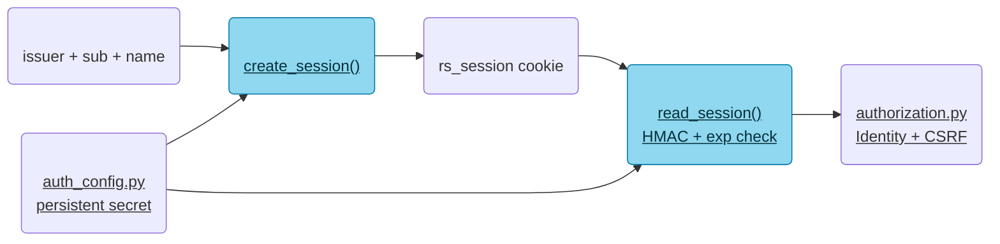

# Signed sessions (`src/recipeserver/session.py`)

Sessions are self-contained: the cookie stores only the issuer, subject, optional display name, a nonce, and an expiry. `sign_payload()` produces `base64url(json).base64url(HMAC-SHA256)`; `verify_payload()` checks the signature with `hmac.compare_digest` before parsing. `read_session()` additionally enforces the embedded expiry and a format version.

`create_session()` returns the cookie value and a `Session`; `Session.key` is the stable **issuer + subject** identity, and `Session.csrf_token()` derives a per-session token from the signed nonce.

## Cookie attributes

`cookie_header()` sets `Path=/`, `HttpOnly`, `SameSite=Lax`, `Max-Age`, and `Secure` when the configured redirect URI is HTTPS. `SameSite=Strict` is deliberately not used: the browser would drop the state cookie on the top-level redirect back from the identity provider. Cross-site mutations are covered by the CSRF token and `Origin` checks in [authorization.py.md](authorization.py.md) instead.

## Tradeoff: signed cookies are not revocable individually

There is no server-side session store. Logging out clears the cookie in that browser but cannot invalidate a copy of it; a disabled identity provider account is not reflected in an already-issued cookie. Permissions, however, are read from the access settings on every request, so changing Guest/authenticated defaults or the Owner subject takes effect without re-login.

Mitigations: a finite, documented session lifetime (12 hours by default) and rotating the signing secret to invalidate every session at once. Never put the client secret or raw ID token in a cookie. `FLOW_COOKIE` uses the same signing primitives for the short-lived, single-use OIDC login flow (see [oidc.py.md](oidc.py.md)).
