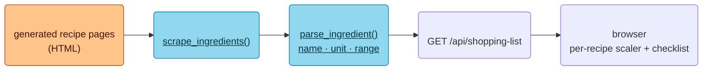

# Shopping list scraping (`src/recipeserver/shopping_list.py`)

Ingredient scraping for the shopping list. The shopping list opens from the index in selection mode; `GET /api/shopping-list?path=…` (repeated) returns each selected recipe's ingredients, and the browser combines them with per-recipe scaling.

The ingredients come from the **generated recipe pages**, not the Markdown: a heading whose text mentions "ingredient" opens an ingredients section, every list item inside the section is an ingredient, and the next heading closes the section again. This module parses the HTML with BeautifulSoup.

## Public surface

- `scrape_ingredients(html)` — walks headings and list items in document order; returns a list of dicts with `html` (inner HTML of the `<li>`, so the caller can render it and keep the `.quantity` spans the recipe scaler needs), `name` (normalized lower-case, punctuation stripped, leading "of" dropped), `unit` (alias-normalized; trailing plural "s" dropped except after "e"/"ss"), and `has_range` (true when the quantity span carries `data-quantity-end`).
- `parse_ingredient(markup)` — the per-item parser used by `scrape_ingredients`. The name and unit say which ingredient it is, so the shopping list can add amounts from several recipes together.
- `HEADING_TAGS`, `INGREDIENT_KEYWORD = "ingredient"`, `_SCRAPE_SELECTOR`, `_NAME_PREFIXES = ("of ",)`, `_PUNCTUATION` — the scraping rules, exported for tests.

## Where it is used

[server.py.md](server.py.md) `_handle_shopping_list_get` — one scrape per selected recipe's generated page. The scaler and the combined-list UI live in `assets/recipe-scaler.js` and `assets/shopping-list/`.

## Related pages

- [server.py.md](server.py.md) — the endpoint
- [markdown_to_html/quantities.py.md](markdown_to_html/quantities.py.md) — produces the `.quantity` spans scraped here
- [README.md](README.md) — the package hub
