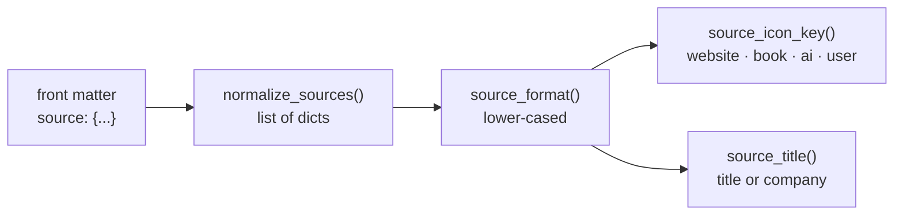

# Source-list helpers (`src/recipeserver/sources.py`)

Shared rendering rules for the recipe's `source` front matter, used by both the recipe page and the index card so the two never drift.

## Public surface

- `TITLED_SOURCE_FORMATS = {"website", "book"}` — the formats that show an explicit "Source" detail on the index card.
- `normalize_sources(metadata)` — the `source` metadata as a list of dicts (a single dict is wrapped; non-dict entries dropped).
- `source_format(source)` — lower-cased `format` string.
- `source_title(source)` — best-effort display title: `title`, falling back to `company` for websites.
- `source_icon_key(fmt)` — maps a format to its icon key: `website`/`book`/`ai`, otherwise `user`.

## Where it is used

[markdown_to_html/extras.py.md](markdown_to_html/extras.py.md) renders the per-recipe sources block; [index_html_generator.py.md](index_html_generator.py.md) renders the card's Source detail (only for `TITLED_SOURCE_FORMATS`).

## Related pages

- [markdown_to_html/extras.py.md](markdown_to_html/extras.py.md)
- [index_html_generator.py.md](index_html_generator.py.md)
- [README.md](README.md) — the package hub
