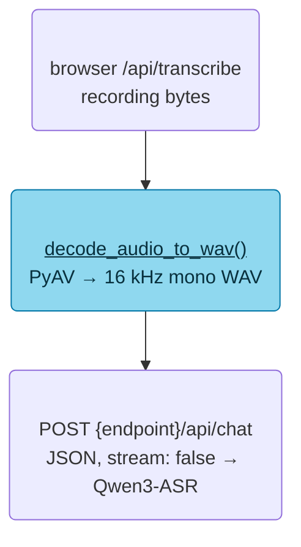

# The transcriber (`src/recipeserver/transcriber.py`)

Local speech-to-text for the dictation button. The browser records a short clip with `MediaRecorder` and posts it to `/api/transcribe`; this module turns that clip into text. The transcription engine is an Ollama server running the Qwen3-ASR model, managed entirely outside RecipeServer — RecipeServer never downloads, installs, launches, or manages Ollama or its models; it only sends the audio and reads back the transcript:

1. the recording is decoded here, with PyAV, into a 16 kHz mono signed-16-bit WAV,
2. the WAV is base64-embedded in a message whose `images` field carries the audio (the transport the Qwen3-ASR GGUF accepts; the plain `audio` message field is not supported) and posted to `POST {transcription_endpoint}/api/chat` — Ollama's native chat route, with `stream: false` and `think: false`, matching every other Ollama request RecipeServer sends,
3. the model's reply (`language <name><asr_text><transcription>`) is normalized and the transcription text is returned.

The Ollama server URL, the model, and `keep_alive` are server-level configuration (`transcription_endpoint`, `transcription_model`, `transcription_keep_alive` — see [config.py.md](config.py.md)). The default server is `http://localhost:11434` and the default model is `hf.co/ggml-org/Qwen3-ASR-0.6B-GGUF:Q8_0`, which must be pulled independently (`ollama pull hf.co/ggml-org/Qwen3-ASR-0.6B-GGUF:Q8_0`).

Decoding happens here rather than at the server because miniaudio-style decoders read WAV/MP3/FLAC/OGG but not the WebM/MP4 containers the browsers record, and because it keeps the decoder testable on its own.

## `decode_audio_to_wav(data)`

Decodes the recording held in memory and returns WAV bytes. The clip is opened from an `io.BytesIO`, resampled to `SAMPLE_RATE = 16000` mono 16-bit samples, and written with the stdlib `wave` module. A recording that cannot be read, or that carries no audio track, raises `TranscriptionError` — the `/api/transcribe` endpoint turns that into a 400, because a corrupt clip is the caller's mistake, not a server failure.

## `normalize_transcription_text(raw)`

Strips the Qwen3-ASR envelope from the model's reply: a leading `language <name><asr_text>` marker (the marker may appear without the language tag) and any trailing special tokens (`<|im_end|>`, `<|endoftext|>`). A reply without the marker is returned verbatim (stripped), so a model that does not use the envelope is not mangled. Everything model-specific is contained in this function and the `<asr_text>` handling — the rest of the application only ever sees clean text. An empty (but well-formed) reply yields `""`, which the browser surfaces as "Nothing was heard. Try again."

## `transcribe_wav(endpoint, model, wav_audio, keep_alive=None)`

Builds the `/api/chat` request body (`model`, `messages: [{role: "user", content: "", images: [<base64 WAV>]}]`, `stream: false`, `think: false`, plus `keep_alive` when configured) and posts it with `urllib`. The configured endpoint is normalized the same way the AI endpoints are (`normalize_ollama_base_url` in [ai_recipe.py.md](ai_recipe.py.md), so a trailing `/v1`-style suffix is accepted and stripped).

Error handling (all surfaced as 503 at the endpoint): connection refused / unreachable server, HTTP errors (a 404 means the model is not installed and raises an actionable "pull it with `ollama pull …`" message; other statuses quote the server's own error body), a response that is not JSON, a payload without a `message`, a message without text content, an oversized response, and request timeouts. The read timeout is `REQUEST_TIMEOUT_SECONDS = 180` because a cold Ollama server loads the model into memory on the first request — cold-start latency is not a connection failure and simply takes longer; once loaded, a short clip transcribes in well under a second.

## `keep_alive`

`transcription_keep_alive` controls how long Ollama keeps the model loaded after a request. `normalize_keep_alive()` maps the configured value to the request body: blank is omitted (Ollama's own default applies, 5 minutes), plain integers become JSON numbers, and duration strings (`30s`, `5m`, `1h`) are passed through verbatim.

## `Transcriber`

- `transcribe(audio, suffix=".webm", *, endpoint, model, keep_alive=None)` — decodes the recording and posts the WAV to the configured server. `suffix` is accepted for compatibility with the browser pipeline; the decoder is content-based. Empty audio raises `ValueError`; an undecodable clip raises `TranscriptionError`; anything wrong with the server or the model raises `TranscriberUnavailable`. The instance is stateless — the endpoint, model, and keep-alive are read from the live configuration on every call, so a Configuration save takes effect immediately.

The shared instance works like this: `get_transcriber()` returns the module-level stateless instance, and [server.py.md](server.py.md) keeps it in its module-level `transcriber` for tests to replace.

## The bundled test sample

`TranscriptionTestSample.wav` in the package root is a short recorded utterance ("Add two cups of flour and one cup of sugar.") used by `POST /api/config/test-transcription` — the **Test transcription** button in the Configuration dialog, which verifies the configured server and model actually transcribe audio before you rely on them.

## Related pages

- [config.py.md](config.py.md) — the `transcription_endpoint` / `transcription_model` / `transcription_keep_alive` settings
- [ai_recipe.py.md](ai_recipe.py.md) — the endpoint normalization shared with the other Ollama integrations
- [server.py.md](server.py.md) — the `/api/transcribe` and `/api/config/test-transcription` endpoints that call the transcriber
- [index_html_generator.py.md](index_html_generator.py.md) — the dictation button in the search field
- [README.md](README.md) — the package hub
