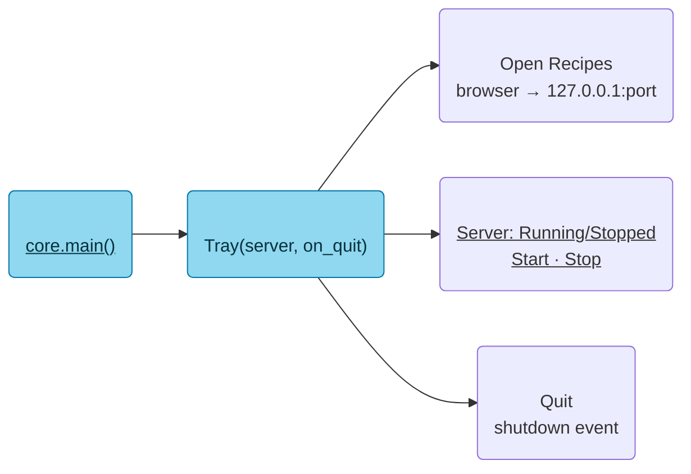

# The system tray (`src/recipeserver/tray.py`)

The `pystray`-based tray icon: open the site, see server status, start/stop the server, quit. Created by [core.py.md](core.py.md)'s `main()` after the server starts.

## `Tray`

`__init__(server, on_quit)` builds a `pystray.Icon("RecipeServer", …)` with a menu:

- **Open Recipes** (default action) — opens `http://127.0.0.1:<port>` in the browser by default; the port is read from `server.port` (falls back to 8000). When the configured bind address (`server.bind_address`) is a wildcard (`0.0.0.0` or `::`) the browser still uses the IPv4 loopback address, since a wildcard bind also listens there. A specific non-loopback bind opens that address instead (IPv6 literals are bracketed), because loopback would not answer. The loopback default, rather than `localhost`, is deliberate: `localhost` may resolve to IPv6 first, which the default IPv4 bind does not listen on.
- **Server: Running/Stopped** — disabled status item, refreshed via `icon.update_menu()` after start/stop.
- **Start Server** / **Stop Server** — visible only when applicable; start failures (e.g. port in use) are logged, and `Server.start()` itself exits the process when the port is taken.
- **Quit** — sets the shutdown event (`on_quit`), which stops the tray and the server.

The icon image is `assets/logo.png` (RGBA). `run()` blocks on the main thread (used on macOS, where the tray must run there); `run_detached()` runs it in the background (used on Windows/Linux, where the main thread polls the quit event instead). `stop()` stops the icon.

## Related pages

- [core.py.md](core.py.md) — constructs and runs the tray
- [server.py.md](server.py.md) — start/stop/is_running semantics
- [README.md](README.md) — the package hub
