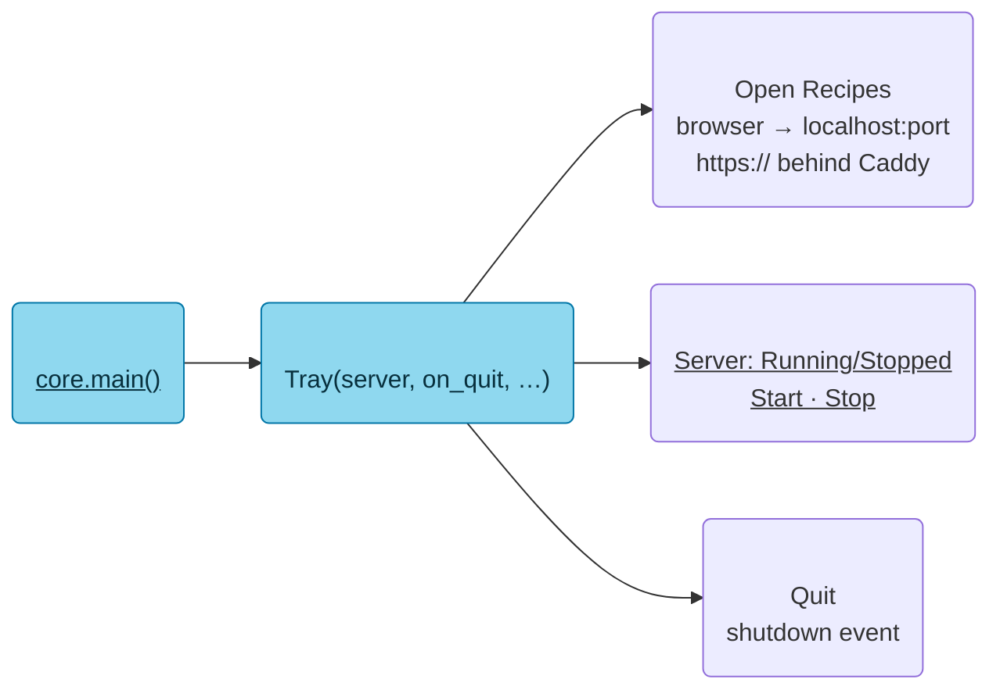

# The system tray (`src/recipeserver/tray.py`)

The `pystray`-based tray icon: open the site, see server status, start/stop the server, quit. Created by [core.py.md](core.py.md)'s `main()` after the server starts.

## `Tray`

`__init__(server, on_quit, on_start=None, on_stop=None)` builds a `pystray.Icon("RecipeServer", …)` with a menu. The optional `on_start`/`on_stop` hooks start and stop the _whole site_ — the embedded server plus the Caddy front-end when HTTPS is enabled ([core.py.md](core.py.md)'s `start_all()`/`stop_all()`); without them the tray drives the embedded server directly, which is all plain HTTP needs.

- **Open Recipes** (default action) — opens `<scheme>://127.0.0.1:<port>` in the browser; the scheme and port come from `server.scheme` and `server.port` (falling back to `http` and 8000). The address is the IPv4 loopback address, not `localhost`, which may resolve to IPv6 first. Behind Caddy the URL is `https://127.0.0.1:<port>`.
- **Server: Running/Stopped** — disabled status item, refreshed via `icon.update_menu()` after start/stop.
- **Start Server** / **Stop Server** — visible only when applicable; failures to start the site (e.g. port in use, or Caddy failing to bind) are logged. `Server.start()` itself exits the process when the port is taken.
- **Quit** — sets the shutdown event (`on_quit`), which stops the tray and the site.

The icon image is `assets/logo.png` (RGBA). `run()` blocks on the main thread (used on macOS, where the tray must run there); `run_detached()` runs it in the background (used on Windows/Linux, where the main thread polls the quit event instead). `stop()` stops the icon.

## Related pages

- [core.py.md](core.py.md) — constructs and runs the tray
- [server.py.md](server.py.md) — start/stop/is_running semantics
- [README.md](README.md) — the package hub
