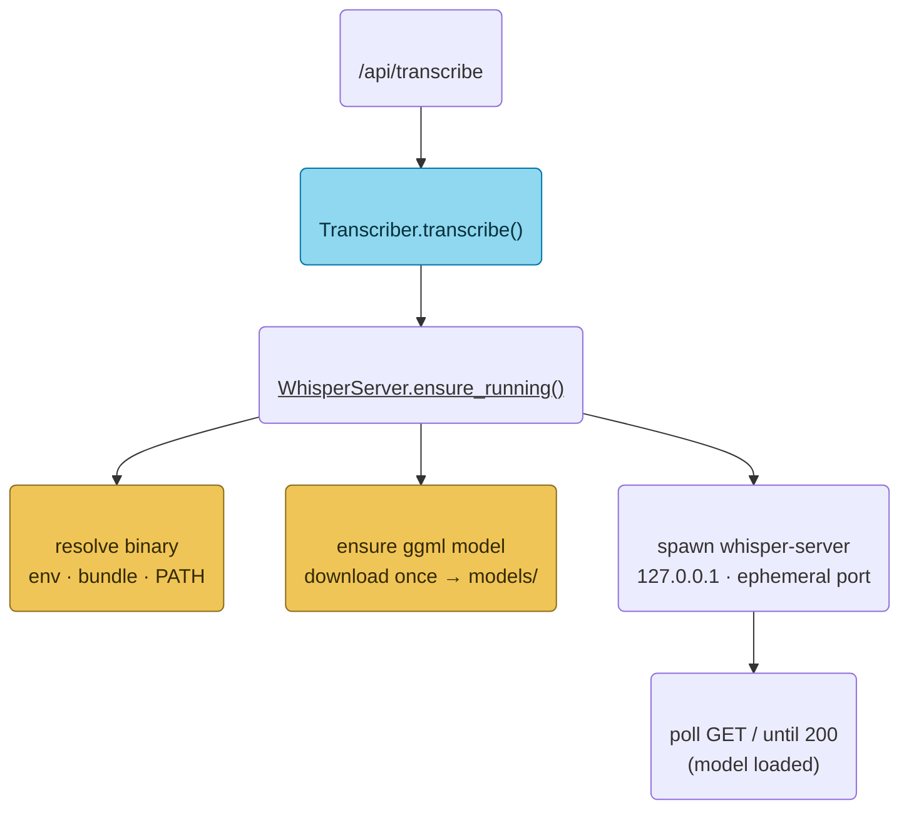

# The whisper-server lifecycle (`src/recipeserver/whisper_server.py`)

RecipeServer talks to [whisper-native](https://github.com/fordaj/whisper-native)'s `whisper-server` for the dictation feature — not a Python package. This module owns that subprocess: finding the binary, downloading the ggml model weights on first use, starting the server, waiting until the model is in memory, and stopping the server again.

`whisper-server` is CPU-only, statically linked where the OS allows, and pinned in `tools/whisper-native/` like the other bundled tools (refreshed by `tools/whisper-native/update.sh`, selected through the env cascade as `WHISPER_SERVER_BIN`). Nothing in the Python dependency tree needs an ML runtime, which keeps `uv sync` working on platforms where `faster-whisper`'s transitive `onnxruntime` has no wheel.

## Binary resolution

`resolve_whisper_server_binary()` checks, in order:

1. the explicit `binary` argument,
2. the `WHISPER_SERVER_BIN` environment variable,
3. the repository bundle: the newest `tools/whisper-native/v*/<platform>/whisper-server[.exe]` matching this machine (`<platform>` is `macos|linux|windows` + `x86_64|arm64`),
4. `whisper-server` on `PATH`.

Anything usable is returned; a missing override points at a clear error instead of a silent fallback, and the not-found message names `WHISPER_SERVER_BIN` and the update script.

## Model weights

The release archives carry no model weights, so `ensure_model()` downloads the ggml file once from Hugging Face (`ggerganov/whisper.cpp`) into `<user-data>/recipe-server/models/` (override with `RECIPE_SERVER_WHISPER_MODEL_DIR`, mostly for tests). The default model is `base`, matching the size the faster-whisper integration used; set `RECIPE_SERVER_WHISPER_MODEL` (for example `tiny`, `base.en`, `small`, `q8_0` variants also work) to change it. Model names are validated (`normalize_model_name()`), so the name is safe to use in a URL and a file name; a download that fails removes its partial file and reports how to place the weights by hand.

## The `WhisperServer` class

- `ensure_running()` — idempotent: a running server is returned as-is. Otherwise it resolves the binary, ensures the model, picks a free loopback port (unless one was given), spawns the server, and waits until it answers `GET /` — whisper-server loads the model _before_ it starts listening, so a 200 means the model is in memory. A server that exits during startup fails with its exit code and the tail of its output. The lock serialises startup with shutdown (it is re-entrant because the error path calls `stop()` while holding it).
- `is_running`, `base_url` — state for callers.
- `stop()` — terminate, wait `STOP_TIMEOUT_SECONDS`, then kill. Idempotent.

The process speaks no authentication and binds `127.0.0.1` on an ephemeral port, so it is only reachable from this machine. It is started lazily — on the first transcription, or never — and it is stopped when the app shuts down (`core.py` calls `stop_transcriber()` from [transcriber.py.md](transcriber.py.md)) and when dictation is disabled in the configuration.

Constants worth knowing: `HOST`, `STARTUP_TIMEOUT_SECONDS = 180.0`, `POLL_INTERVAL_SECONDS`, `STOP_TIMEOUT_SECONDS`, `DOWNLOAD_CHUNK_BYTES`, `OUTPUT_TAIL_BYTES`, and the env vars `WHISPER_SERVER_BIN`, `RECIPE_SERVER_WHISPER_MODEL`, `RECIPE_SERVER_WHISPER_MODEL_DIR`.

## Related pages

- [transcriber.py.md](transcriber.py.md) — the decode-and-POST client that drives this server
- [server.py.md](server.py.md) — the `/api/transcribe` endpoint
- [core.py.md](core.py.md) — where `stop_transcriber()` is called
- [README.md](README.md) — the package hub
