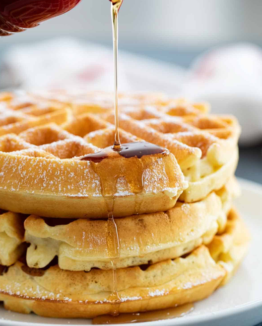

---
meals:
  - Breakfast
---

# Sample

/// html | div.recipe-meta

Time
: 20 minutes

Serves
: `6 samples`

/// <!-- recipe-meta -->

## Fractions

- [ ] `1/8 cup` 1/8 cup
- [ ] `1/4 cup` 1/4 cup
- [ ] `1/3 cup` 1/3 cup
- [ ] `1/2 cup` 1/2 cup
- [ ] `2/3 cup` 2/3 cup
- [ ] `3/4 cup` 3/4 cup
- [ ] `7/8 cup` 7/8 cup

- [ ] `1 1/8 cup` 1 1/8 cup
- [ ] `1 1/4 cup` 1 1/4 cup
- [ ] `1 1/3 cup` 1 1/3 cup
- [ ] `1 1/2 cup` 1 1/2 cup
- [ ] `1 2/3 cup` 1 2/3 cup
- [ ] `1 3/4 cup` 1 3/4 cup
- [ ] `1 7/8 cup` 1 7/8 cup

- [ ] `10 1/8 cup` 10 1/8 cup
- [ ] `10 1/4 cup` 10 1/4 cup
- [ ] `10 1/3 cup` 10 1/3 cup
- [ ] `10 1/2 cup` 10 1/2 cup
- [ ] `10 2/3 cup` 10 2/3 cup
- [ ] `10 3/4 cup` 10 3/4 cup
- [ ] `10 7/8 cup` 10 7/8 cup

## Conventional Units

- [ ] `1 cup` 1 cup
- [ ] `2 cups` 2 cups
- [ ] `1/2 cup` 1/2 cup
- [ ] `1/2 cup` 1/2 cup
- [ ] `1 tbsp` 1 tbsp
- [ ] `1 tablespoon` 1 tablespoon
- [ ] `2 tablespoons` 2 tablespoons
- [ ] `1000 tbsp` 1000 tbsp
- [ ] `1/2 tsp` 1/2 tsp
- [ ] `1/2 teaspoon` 1/2 teaspoon

## Numeric Units

- [ ] `1lb` 1lb
- [ ] `1oz` 1oz
- [ ] `1g` 1g
- [ ] `1mL` 1mL
- [ ] `1L` 1L

- [ ] `1 lb` 1 lb
- [ ] `1 oz` 1 oz
- [ ] `1 g` 1 g
- [ ] `1 mL` 1 mL
- [ ] `1 L` 1 L

## Edge Cases

- [ ] `2 large eggs`
- [ ] `2 potatoes`
- [ ] `1 potato`
- [ ] `1 3/4 cups` (`415mL`) milk or buttermilk
- [ ] `1/3 cup` (`75 mL`) vegetable oil or melted butter
- [ ] `1 teaspoon` vanilla extract

## Instructions

1. Preheat your waffle iron.
1. In a bowl, whisk the eggs, milk, oil/butter, and vanilla.
1. Add the `2 cups` of the dry waffle mix and stir until just combined (lumps are okay—don't overmix).
1. Cook in a preheated waffle iron per manufacturer’s instructions (usually 3–5 minutes until golden).
1. Serve warm with toppings like butter, syrup, fruit, or whipped cream.

## Tips

- Storage plate in oven at 180°F
- Liberally brush butter onto waffle maker between waffles
