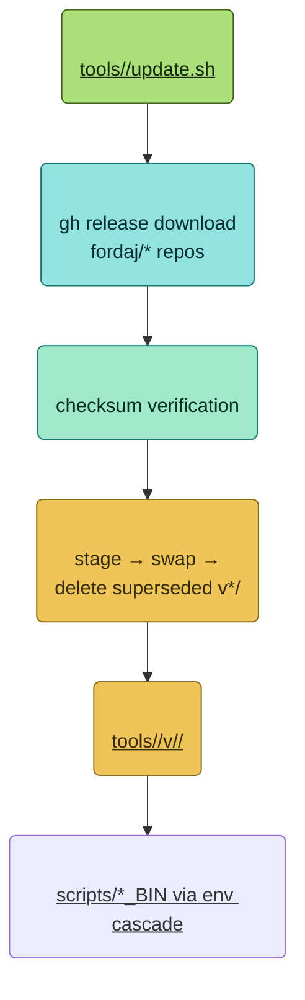

# Pinned helper tools (`tools/`)



`tools/` carries the repository's pinned helper binaries — build, release, logging, and docs tooling — plus one `update.sh` per tool that refreshes them. These are **not** the formatters [format.sh](../scripts/format.sh.md) orchestrates (formattington is the primary path, as a pinned `uv` dev dependency; formattington-lite here is the fallback); they are the tools used to build, test, log, and document this repository itself, consumed by the scripts via the [env cascade](../scripts/env.sh.md).

## Bundling convention

Every bundle follows the same layout:

```text
tools/<name>/
  update.sh           # refresh from the upstream GitHub release
  v<version>/<platform>/<binary>[.exe]
```

- Binaries are pinned by version directory; the pinned version is named by `*_VERSION_DIR` in [`scripts/.common.env`](../scripts/env.sh.md).
- `<platform>` is the hyphenated `<os>-<arch>` name (`linux-x86_64`, `macos-arm64`, `windows-x86_64`, …).
- `update.sh` downloads the latest (or `--tag`ged) upstream release via `gh`, verifies checksums when the release ships them, stages into a temporary directory, swaps in atomically, and deletes superseded version folders only after the new one is staged — a failed refresh leaves the previous bundle intact. Each script has `--dry-run`, `--help`, and resolves its own directory, so it can run from anywhere.
- Only the binary is kept, except [formattington-lite](formattington-lite/update.sh.md), which also retains `NOTICE.md` and `LICENSES/` per platform directory, and [barnacle](barnacle/update.sh.md), which copies an upstream `LICENSE` into each platform directory when the release archives ship one.

## The bundles

| Tool | Used for | Docs |
| --- | --- | --- |
| [versioner](versioner/update.sh.md) | Computes the repository version (`scripts/version.sh`, `scripts/release.sh`) | [update.sh](versioner/update.sh.md) |
| [logamuffin](logamuffin/update.sh.md) | Logging backend for `log()` in [scripts/entry.sh](../scripts/entry.sh.md) | [update.sh](logamuffin/update.sh.md) |
| [runner-spawner](runner-spawner/update.sh.md) | Self-hosted CI runners ([spawn-runners.sh](../scripts/spawn-runners.sh.md)) | [update.sh](runner-spawner/update.sh.md) |
| [barnacle](barnacle/update.sh.md) | Documentation site generation ([scripts/docs.sh](../scripts/docs.sh.md)) | [update.sh](barnacle/update.sh.md) |
| [formattington-lite](formattington-lite/update.sh.md) | Formatting fallback; the pinned uv dev dependency is the primary path | [update.sh](formattington-lite/update.sh.md) |

Currently pinned: versioner `v0.0.3.0.17`, logamuffin `v0.1.3.0.35`, runner-spawner `v0.0.1.2.16`, barnacle `v0.0.2.1.25`, formattington-lite `v0.0.3.0.67`. `scripts/.common.env` and `scripts/.<platform>.env` select these via `*_VERSION_DIR`/`*_BIN`; see [scripts/env.sh.md](../scripts/env.sh.md). Archives are platform-native (`.tar.gz` on macOS/Linux, `.zip` on Windows); legacy `.7z` assets are still readable (a p7zip install is only needed until new releases ship platform-native archives).

## Refreshing a pinned tool

```bash
tools/barnacle/update.sh            # download the latest release, verify, swap
tools/barnacle/update.sh --dry-run  # show what would change
```

(Same flags for the other four.) Checksum verification accepts `checksums.txt` or `SHA256SUMS.txt`; missing file: a warning, except runner-spawner, which refuses to install unverified binaries.

## Related pages

- [../scripts/env.sh.md](../scripts/env.sh.md) — how the cascade selects these binaries
- [../scripts/docs.sh.md](../scripts/docs.sh.md) — barnacle in action
- [../spawn-runners.sh.md](../scripts/spawn-runners.sh.md) — runner-spawner in action
- [../format.sh.md](../scripts/format.sh.md) — the formatting entry point
- [../README.md](../README.md)
