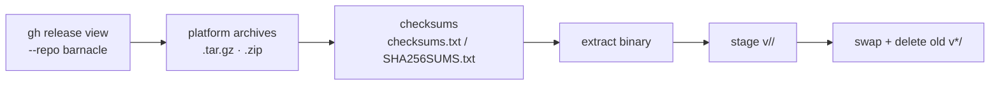

# The barnacle bundle (`tools/barnacle/`)



[Barnacle](https://github.com/fordaj/barnacle) is a documentation-site generator: it renders the `.md` and `.mmd` files scattered through a repository into a static, navigable HTML site. RecipeServer uses it to render *this* documentation; the site you may be reading was built by it.

## Layout

```text
tools/barnacle/
  update.sh                     # refresh from fordaj/barnacle releases
  v0.0.1.0.17/
    macos-arm64/barnacle
    macos-x86_64/barnacle
    linux-arm64/barnacle
    linux-x86_64/barnacle
    windows-arm64/barnacle.exe
    windows-x86_64/barnacle.exe
```

## `update.sh` in detail

Archives are `.tar.gz` (macOS/Linux) and `.zip` (Windows); each is expected to carry a top-level directory with the binary. The script:

1. Resolves the tag (latest release, or `--tag vX.Y.Z...`), validating the tag shape (`vX.Y.Z...`). `--repo`/env `BARNACLE_REPO` override the upstream repository slug (default `fordaj/barnacle`; env `BARNACLE_TAG` pins the tag, overridden by `--tag`).
2. Downloads via `gh`, then verifies every downloaded archive against the upstream `checksums.txt` or `SHA256SUMS.txt` (`shasum -a 256 -c` or `sha256sum -c`). A missing checksum for a downloaded asset is fatal; a release without any checksums file only warns.
3. Extracts each archive (`tar` for `.tar.gz`; `unzip`, falling back to `7z`/`7zz` for `.zip`), copies the binary into `v<tag>/<platform>/`, and makes it executable.
4. Copies an upstream `LICENSE` into each platform directory when the archive ships one (`cp -p` preserving mode). The current `v0.0.1.0.17` bundle carries no `LICENSE`; the option exists for future releases.
5. Swaps in the new version directory and deletes superseded `v*/` ones, then smoke-tests the host binary (`barnacle --version`).

Unknown arguments exit `2`. `--dry-run` lists assets and what would change without touching anything.

## How the repository uses it

[scripts/docs.sh](../../scripts/docs.sh.md) resolves `BARNACLE_BIN` through the [env cascade](../../scripts/env.sh.md) and generates `./site/` from the repo root; the output is git-ignored.

## Related pages

- [../README.md](../README.md) — the bundle index
- [../../scripts/README.md](../../scripts/README.md) — the scripts that consume the bundle
