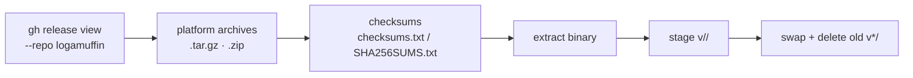

# The logamuffin bundle (`tools/logamuffin/`)



[Logamuffin](https://github.com/fordaj/logamuffin) is a structured-logging binary: the backend behind the `log()` shell function defined in [scripts/entry.sh](../../scripts/entry.sh.md). Every repository script routes its output through it, with a printf fallback when the binary is missing.

## Layout

```text
tools/logamuffin/
  update.sh                     # refresh from fordaj/logamuffin releases
  v0.1.3.0.35/
    macos-arm64/logamuffin
    macos-x86_64/logamuffin
    linux-arm64/logamuffin
    linux-x86_64/logamuffin
    windows-arm64/logamuffin.exe
    windows-x86_64/logamuffin.exe
```

## `update.sh` in detail

Archives are `.tar.gz` (macOS/Linux) and `.zip` (Windows). The script:

1. Resolves the tag (latest release, or `--tag vX.Y.Z...`), validating the tag shape. `--repo`/env `LOGAMUFFIN_REPO` override the slug (default `fordaj/logamuffin`; env `LOGAMUFFIN_TAG` pins the tag, overridden by `--tag`).
2. Downloads via `gh` and verifies downloaded archives against `checksums.txt` or `SHA256SUMS.txt`. A missing checksum for a downloaded asset is fatal; a release without any checksums file only warns.
3. Extracts each archive, copies the `logamuffin` binary into `v<tag>/<platform>/`, makes it executable, and verifies it is non-empty.
4. Swaps in the new version directory and deletes superseded `v*/` ones, then smoke-tests the host binary (`logamuffin --version`).

Only the binary is kept — no LICENSE or NOTICE files are retained by this bundle. Unknown arguments exit `2`. `--dry-run` lists assets and what would change without touching anything.

## How the repository uses it

[scripts/entry.sh](../../scripts/entry.sh.md) resolves `LOGAMUFFIN_BIN` through the [env cascade](../../scripts/env.sh.md) and forwards every `log LEVEL MESSAGE…` call to the binary with `LOG_SOURCE` set to the call site; when the binary is absent, `log()` falls back to a printf implementation. `scripts/release.sh` logs a warning naming `tools/logamuffin/update.sh` when the binary is missing.

## Related pages

- [../README.md](../README.md) — the bundle index
- [../../scripts/entry.sh.md](../../scripts/entry.sh.md) — the `log()` consumer
- [../../scripts/README.md](../../scripts/README.md)
