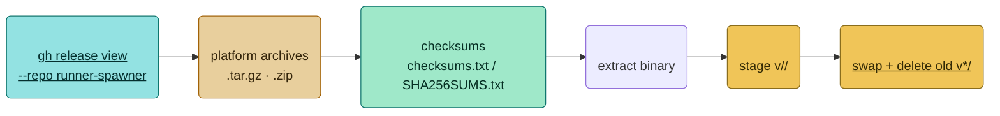

# The runner-spawner bundle (`tools/runner-spawner/`)



[runner-spawner](https://github.com/fordaj/runner-spawner) creates and manages self-hosted GitHub Actions runners. RecipeServer uses it to provision the two repository-scoped runners named in `.runner-spawner.json` (`runner01`, `runner02`; group `Default`; runner version `2.338.2`; install directory `.runners/`, gitignored) that back the self-hosted CI described in the root [README.md](../../README.md).

## Layout

```text
tools/runner-spawner/
  update.sh                     # refresh from fordaj/runner-spawner releases
  v0.0.1.2.16/
    macos-arm64/runner-spawner
    macos-x86_64/runner-spawner
    linux-arm64/runner-spawner
    linux-x86_64/runner-spawner
    windows-arm64/runner-spawner.exe
    windows-x86_64/runner-spawner.exe
```

## `update.sh` in detail

Archives are `.tar.gz` (macOS/Linux) and `.zip` (Windows). The script:

1. Resolves the tag (latest release, or `--tag vX.Y.Z...`), validating the tag shape. `--repo`/env `RUNNER_SPAWNER_TOOL_REPO` override the slug (default `fordaj/runner-spawner`; env `RUNNER_SPAWNER_TAG` pins the tag, overridden by `--tag`). The env variable is deliberately `RUNNER_SPAWNER_TOOL_REPO`, not `RUNNER_SPAWNER_REPO`, so the release updater cannot collide with the target-repository selector the binary itself reads (`RUNNER_SPAWNER_REPO`/`RUNNER_SPAWNER_OWNER`) — [spawn-runners.sh](../../scripts/spawn-runners.sh.md) unsets those before invoking the binary.
2. Downloads via `gh` and verifies downloaded archives against `checksums.txt` or `SHA256SUMS.txt`. **A release without a checksums file is fatal here** (`refusing to install unverified binaries`) — the one bundle of the five that refuses to install unverified binaries.
3. Extracts each archive, copies the `runner-spawner` binary into `v<tag>/<platform>/`, makes it executable, and verifies it is non-empty.
4. Swaps in the new version directory and deletes superseded `v*/` ones, then smoke-tests the host binary (`runner-spawner --version`).

Only the binary is kept. Unknown arguments exit `2`. `--dry-run` lists assets and what would change without touching anything.

## How the repository uses it

[spawn-runners.sh](../../scripts/spawn-runners.sh.md) resolves `RUNNER_SPAWNER_BIN` through the [env cascade](../../scripts/env.sh.md) and runs `runner-spawner create --config .runner-spawner.json`. The tool is macOS/Windows only; the Linux binaries ship for bundle uniformity but report unsupported, and requesting the registration token requires `gh` to be authenticated (or `--token`).

## Related pages

- [../README.md](../README.md) — the bundle index
- [../../spawn-runners.sh.md](../../scripts/spawn-runners.sh.md) — the consumer
- [../../scripts/README.md](../../scripts/README.md)
