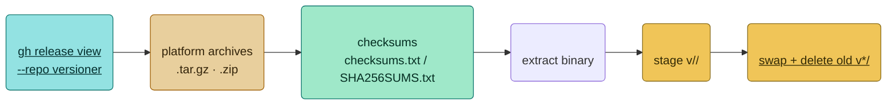

# The versioner bundle (`tools/versioner/`)



[Versioner](https://github.com/fordaj/Versioner) computes the repository version from git history. RecipeServer uses it to guarantee that the version of a build and the version of a release can never drift apart: [scripts/version.sh](../../scripts/version.sh.md) prints it locally, and [scripts/release.sh](../../scripts/release.sh.md) computes the tag it publishes. The version configuration lives in `.versioner.json` at the repository root (`tagPattern: "v[0-9]*"`, `defaultBranchVersion: 254`, `exemptBranches: { "main": 0 }`).

## Layout

```text
tools/versioner/
  update.sh                     # refresh from fordaj/Versioner releases
  v0.0.3.0.17/
    macos-arm64/versioner
    macos-x86_64/versioner
    linux-arm64/versioner
    linux-x86_64/versioner
    windows-x86_64/versioner.exe
```

Note: there is no windows-arm64 bundle upstream (and this repository carries no windows-arm64 versioner either); `.windows-arm64.env` points `VERSIONER_BIN` at the windows-x86_64 binary instead and advises falling back to a versioner on PATH (see [scripts/env.sh.md](../../scripts/env.sh.md)).

## `update.sh` in detail

Archives are `.tar.gz` (macOS/Linux) and `.zip` (Windows). The script:

1. Resolves the tag (latest release, or `--tag vX.Y.Z...`), validating the tag shape. `--repo`/env `VERSIONER_REPO` override the slug (default `fordaj/Versioner` — note the capital V —; env `VERSIONER_TAG` pins the tag, overridden by `--tag`).
2. Downloads via `gh` and verifies downloaded archives against `checksums.txt` or `SHA256SUMS.txt`. A missing checksum for a downloaded asset is fatal; a release without any checksums file only warns.
3. Extracts each archive, copies the `versioner` binary into `v<tag>/<platform>/`, makes it executable, and verifies it is non-empty.
4. Swaps in the new version directory and deletes superseded `v*/` ones, then smoke-tests the host binary (`versioner --version`).

Only the binary is kept. Unknown arguments exit `2`. `--dry-run` lists assets and what would change without touching anything.

## How the repository uses it

[scripts/version.sh](../../scripts/version.sh.md) runs `versioner --repo-dir <root> --quiet [--format json]` and re-emits `VERSION=`/`TAG=` (text), `export VERSION=`/`export TAG=` (shell), or the raw JSON; [scripts/release.sh](../../scripts/release.sh.md) uses the computed `TAG` for the annotated tag and GitHub release. The git tag drives the package version in `pyproject.toml` (`dynamic = ["version"]`, setuptools-scm).

## Related pages

- [../README.md](../README.md) — the bundle index
- [../../scripts/version.sh.md](../../scripts/version.sh.md) · [../../scripts/release.sh.md](../../scripts/release.sh.md)
- [../../scripts/README.md](../../scripts/README.md)
